# Moss API 研发 PRD｜MVP-P0

交付核对：2026-10-28。请求主表 8 列、详情 12 字段、页面宽度 1200px；增加零扣费失败样例，统一单行截断和 API Key ID。功能基线 2beca7c，Vercel production READY；正式站点 8 列、12 字段及含失败请求 CSV 已核验。

[线上原型｜API Keys](https://moss-api-mvp-p0-compromise.vercel.app/app/api-keys)

[新版 Figma｜Moss API MVP-P0 产品需求与 UI 交接](https://www.figma.com/design/uKJHefil0SBm8xMnc37NnE)

[GitHub｜公开代码仓库](https://github.com/h-pl/moss-api-mvp-p0-compromise)

[GitHub｜当前功能基线｜15d55ae](https://github.com/h-pl/moss-api-mvp-p0-compromise/commit/15d55ae8349658f8b77309465b31d2fbf31fa1ee)；[首版历史标签](https://github.com/h-pl/moss-api-mvp-p0-compromise/tree/moss-api-mvp-p0-compromise-v1.0.0-20260914)

## 更新日志

正文定义当前有效需求，日志记录每批变更的影响范围；同日按批次区分，最新记录在前。同步完成范围以每条记录为准，代码提交与画板链接用于追溯。

| 日期 / 批次 | 更新主题 | 影响范围 | 更新内容 | 对应提交 / 记录 |
| --- | --- | --- | --- | --- |
| 2026-10-28 / 01 | 请求明细字段与布局定稿 | 企业 / 个人主表、详情、CSV；四端交付 | 主表 8 列、详情 12 字段；1200px 宽、单行截断；失败请求可查看及导出，计费汇总一致。 | 2beca7c；[发布记录](发布说明-20261028.md) |
| 2026-10-26 / 03 | 导出汇总长名称省略 | 企业 / 个人导出汇总表；线上与飞书 PRD | 长名称超出列宽时单行末尾省略，悬停查看完整名称；CSV 保留完整值。 | 15d55ae；Vercel production READY，线上 37 个超长名称验证通过。 |
| 2026-10-26 / 02 | 纠正额外页面说明 | 企业 / 个人导出弹窗、概览提示；线上与飞书 PRD | 删除新增的导出底部整段说明，恢复概览原提示；保留确认的字段、名称、文件名时间及原有请求范围说明。替换两张相关截图。 | bfe31c4；Vercel production READY。 |
| 2026-10-26 / 01 | 最终 CSV 模板与页面名称统一 | 个人 / 企业用量页面、请求详情、明细导出；线上与飞书 PRD | 两种名称统一为用量汇总（按模型与 API Key）、请求用量明细；CSV 为 13 / 16 列，删除单价两列，明确名称、备注、时间、状态、单位及折算金额；文件名使用实际下载时的秒级北京时间。页面和说明统一为已计费请求口径。 | a796af7；Vercel production READY。详见 [发布记录](发布说明-20261026.md)。 |
| 2026-10-22 / 01 | 账单补齐完整三阶梯 | 企业账单预览 / 打印；飞书 7.6、8.1 与更新日志 | ASR 固定展示 ≤500、>500、>1,000；Kimi 固定展示 ≤100、>100、>200。缺失档位补零、保留单价与首档标签，已有费用和合计不变。增加线上截图，保留字号、样式及按模型自然分页规则。 | [1d174a5](https://github.com/h-pl/moss-api-mvp-p0-compromise/commit/1d174a51ef0610d6a6f748e1df8ebf424fef3c09)；Vercel production READY。 |
| 2026-10-17 / 04 | 补齐多选与账单 Key 规则、更新滚动条截图 | 飞书 7.3、7.5、7.6、7.7；本地 PRD | 创建 Key 图更新为滚动条自动隐藏后的正式版本；模型 / Key 多选独立状态表，补齐全部、部分、选满与空选回退；账单摘要独立表说明单选、多选、全部隐藏、N 计数、长名称、打印及导出。更新 6 处截图。 | 正文和截图基线 cf02d14；仅图文更新 |
| 2026-10-17 / 03 | 企业计价、三档账本及正式发布 | 企业 API Keys、企业计费、企业 / 个人用量与导出；生产与飞书截图 | 统一四组计费说明、Kimi 阈值与档内间距，补齐基础转写三档；企业 Key 列表移除重复提示。v8 将本月三阶梯用量分散到多日，补充 Key 与调用明细同源。个人采用公开标准价。替换 17 处正式站点截图，构建与金额一致性核验通过。 | 功能提交 d45da85；Vercel production READY。 |
| 2026-10-17 / 02 | 统一滚动条按活动自动隐藏 | 页面、表格、筛选菜单、Key 表单、账单预览与导出明细 | 页面控制静止隐藏、滚动显示，停止 800ms 后以 180ms 淡出；悬停与拖动滑块时保持显示，透明轨道且内容宽度稳定。减少动态效果与高对比模式单独处理。补充同位置滚动 / 静止截图，修正原“跟随系统即自动隐藏”的表述。 | 本次修复；浏览器验证页面、Key 菜单、账单、导出、横向表格、滑块拖动及键盘滚动；TypeScript、ESLint、生产构建通过。 |
| 2026-10-17 / 01 | 补齐去外圈及统一边线后的页面截图 | 工作空间切换、企业 / 个人 Key 列表与创建 / 编辑、空选校验、请求详情、计费标准、充值 / 企业支付 | 替换 16 张旧图，补充 2 张编辑弹窗图，共 18 张。截图覆盖搜索框、名称和备注聚焦：无深色焦点外圈或外扩阴影，保留浅灰输入框边线；模型列表与请求详情末行无多余分隔线，滚动轨道透明，弹窗间距统一。本批仅补齐图文，不更改应用行为。 | 截图基线 c005124（功能基线 62df604）；对应章节 7.1、7.3、7.5、7.8。 |
| 2026-10-16 / 02 | 多选语义、Key 省略与统一导出 | 用量筛选、账单预览 / 打印、导出明细与 CSV | “全部”表示不限条件；Key 下拉中间省略、账单摘要末尾省略并保留选中总数。全部 Key 隐藏摘要，移除模型范围。明细共用账单模板和合计，CSV 时间进入文件名。36 个企业 Key 长列表验证，替换对应生产截图和 PDF 渲染图。 | [62df604](https://github.com/h-pl/moss-api-mvp-p0-compromise/commit/62df60415e129f3ab461984fd6fa701d370dd7a2) |
| 2026-10-16 / 01 | 完善阶梯样例、多选筛选与账单样式 | 用量、API Keys、账单预览 / 打印、导出及积分弹窗；线上与飞书 PRD | Kimi 近七天调整为 149 次 / 442.01 积分，按月累计跨档；企业授权和峰值补齐 Kimi。模型 / Key 多选及全选反馈；图表配色、列宽、弹窗内边距和滚动条统一。账单保留字号，组内间距 3.5、档间 9，标签仅首档，线宽统一；筛选范围单行省略。更新线上截图；实际 PDF 待用户文件核验。 | [3fe0f3f（含 805657e）](https://github.com/h-pl/moss-api-mvp-p0-compromise/commit/3fe0f3f) |
| 2026-10-15 / 01 | 新增阶梯计价与阶梯账单 | 企业用量、账单预览 / 打印、CSV；本地与飞书 PRD | 新增按自然月累计、分段累进的阶梯计价：Kimi 按输入与输出总 tokens 划分 100 M / 200 M 档位，ASR 按 500 / 1,000 小时划分三档，各段按对应费率计费。账单展示实际发生的档位、单价、用量和金额；日期筛选只汇总结算快照，不从筛选起点重新计价。合并跨日期相同模型与规则行，支持续页，并保持账单与 CSV 一致。 | [28fbe0e](https://github.com/h-pl/moss-api-mvp-p0-compromise/commit/28fbe0e)（含 3074509） |
| 2026-10-08 / 01 | 计费与用量界面更新 | 企业 / 个人计费标准、请求明细、账单预览 / 打印、导出明细；飞书 7.5—7.8 及截图 | 计费规则拆列；请求明细新增计费用量，详情移除结算单价；统一账单与明细的标题、摘要、表格字号及两端对齐；统一“折后金额”文案，移除 CSV 提示。更新 17 处截图及实际 PDF 单页验证图。该批仅调整展示，未新增阶梯计价，计费、费率、筛选、Key、账户和充值逻辑不变。验收：46 项 Platform、45 项旧 MVP 检查及 ESLint、TypeScript、生产构建通过，企业 / 个人 PDF 均为 A4 横向 1 页。 | [v1.0.2-20261008](https://github.com/h-pl/moss-api-mvp-p0-compromise/tree/moss-api-mvp-p0-compromise-v1.0.2-20261008) [源码基线 bf1a3d1](https://github.com/h-pl/moss-api-mvp-p0-compromise/commit/bf1a3d18eae596b878fa8d907d8eebbf9d76e896) |
| 2026-09-30 / 02 | 替换旧截图、补核原生打印 | API Key 授权模型空选；企业 / 个人打印；PDF 文件名 | Figma 空选图改为线上顶部与校验区两张截图；两张旧打印图替换为当前 Chrome 原生打印预览；确认横向单页与企业默认文件名，账单命名规则位于 7.6 节。 | [bf1a3d1](https://github.com/h-pl/moss-api-mvp-p0-compromise/commit/bf1a3d1) |
| 2026-09-30 / 01 | 账单模板、PDF 命名及 mock 日期扩展 | 企业 / 个人账单预览与打印；用量筛选和请求；本地与飞书 PRD | 四项摘要、无灰色间距及滚动条，顶部留白缩小；PDF 按账户与账期命名。mock 补齐至 10 月 31 日，未来区间不提前计入已结算余额。更新企业、个人账单及 10 月请求三张线上截图；Figma 历史画板本次未同步。 | [模板与 mock：acde37a](https://github.com/h-pl/moss-api-mvp-p0-compromise/commit/acde37a)；[文件命名：1bf87df](https://github.com/h-pl/moss-api-mvp-p0-compromise/commit/1bf87df)； |
| 2026-09-15 / 06 | 截图、设计稿及个人说明同步 | 企业 / 个人计费标准、账单预览、请求详情、两种导出状态；账单打印画板；本地与飞书 PRD | 个人说明恢复“调用统一按积分结算；人民币仅用于购买积分包。”；替换最新线上截图，补充个人导出、请求详情及实际打印预览；Figma 同步四列计费规则、账户标识、数值列宽、移除折扣和末尾分隔线，新增企业 / 个人可编辑打印画板及入口连线。企业与个人实际打印均已核验并补齐截图：A4 横向、1 页，表头、六个模型与合计完整，页脚仅保留生成时间。 | [f9948f9](https://github.com/h-pl/moss-api-mvp-p0-compromise/commit/f9948f9)；[Figma 用量与积分](https://www.figma.com/design/uKJHefil0SBm8xMnc37NnE?node-id=7-21) |
| 2026-09-15 / 05 | PRD 更新记录 | 文档开头；本地与飞书 PRD | 新增更新日志表，补录最近四批变更；后续每次更新正文时，同步记录影响空间、页面、打印 / 导出范围及对应提交。 | 本次文档更新 |
| 2026-09-15 / 04 | 打印页脚与企业说明 | 企业 / 个人账单打印；企业计费标准 | 打印页脚仅保留生成时间（UTC+8），不重复账户与账单日期；企业页头改为“星河科技 · 企业专属计费规则，仅在消耗积分时生效”。 | [f38db12](https://github.com/h-pl/moss-api-mvp-p0-compromise/commit/f38db12) |
| 2026-09-15 / 03 | 个人导出账户标识 | 个人导出明细弹窗；两种 CSV；下载文件名 | 账户统一采用“用户名 · 用户ID”，mock 为“林晓 · 2090649342695182666”；空间类型与切换入口仍使用“个人空间”。 | [58c45c0](https://github.com/h-pl/moss-api-mvp-p0-compromise/commit/58c45c0) |
| 2026-09-15 / 02 | 计费展示、导出字段与布局 | 企业 / 个人计费标准、请求详情、账单预览 / 打印、导出明细 | 计费标准统一为模型、计费方式、计费规则、最低扣费四列；请求详情及逐请求 CSV 不展示模型折扣；账单与导出表格调整列宽；个人用户 ID 使用数字字符串 2090649342695182666。 | [4657595](https://github.com/h-pl/moss-api-mvp-p0-compromise/commit/4657595) |
| 2026-09-15 / 01 | 账单计费规则与个人抬头 | 企业 / 个人账单预览及 PDF 打印 | 列名统一为“计费规则”，仅展示生效单价与单位；企业不展示划线原价和折扣标签，个人不展示“标准价”标签；个人抬头采用用户名与用户 ID。 | [876efe9](https://github.com/h-pl/moss-api-mvp-p0-compromise/commit/876efe9) |

## 概要

Moss API 为企业 Owner 与个人用户提供 API Key 管理、模型授权、用量与积分查询、账单打印和明细导出。企业 Owner 按企业模型权益为每把 Key 设置可用模型及并发上限，个人用户为自己的 Key 设置模型范围；两个空间分别管理 Key、计量和积分。

本轮 MVP-P0 的研发调整集中在：将企业配置落实到 Key、沿用 Platform 页面结构、补齐个人模型范围、统一计费请求与导出口径，并使筛选、金额精度和历史归因在页面、PDF 与 CSV 中一致。正文按最终行为交付，各项调整定位见 3.2。

## 协作分工

| 职责 | 负责内容 | 交付物 |
| --- | --- | --- |
| 产品 | 页面范围、字段、状态、计费与并发口径 | 本 PRD、验收结论与待确认项 |
| 设计 | 页面状态、组件、尺寸、交互路径 | 新版 Figma 与交互说明 |
| 前端 | 身份切换、表单、筛选、图表、打印和导出 | 与原型一致的页面及服务接入 |
| 账号与 Key 服务 | 可信空间权限、Key 签发与撤销、策略保存 | 一次性明文、掩码、稳定 Key ID、授权结果 |
| 网关与资源服务 | 企业及 Key 的模型并发控制 | 原子接纳、超限拒绝、结束释放、峰值接口 |
| 计量与账务 | 已计费请求、费率快照、积分和金额 | 同范围可对账的数据及导出 |
| 模思运营与测试 | 企业开通与模型权益配置；跨场景验收 | 运营配置记录、联调和回归证据 |

具体负责人、接口评审人和联调时间由项目启动会确认；本文不预设人员分配与工期承诺。

## 背景与交付范围

企业客户需要按模型合同权益使用 API，并按不同项目或用途管理调用凭证。Owner 要能判断每把 Key 的授权范围、控制峰值并核对费用；个人用户同样需要限制 Key 可以调用的模型。产品在现有 Platform 体验中完成这些任务，减少凭证误配和人工对账。

### 页面地图与线上入口

| 分组 | 页面 / 路径 | 适用空间 | 主要任务 |
| --- | --- | --- | --- |
| 配置 | API Keys · /app/api-keys | 企业 / 个人 | 创建、编辑、启停、删除 Key，查看授权与用量 |
| 账单与用量 | 用量与积分 · /app/usage | 企业 / 个人 | 筛选计费用量、查看趋势和请求明细、打印账单与导出 CSV |
| 账单与用量 | 计费标准 · /app/pricing | 企业 / 个人 | 查看积分包、模型费率；企业查看折扣价 |
| 通用入口 | 获取积分 / 充值弹窗 | 企业 / 个人 | 个人充值、企业支付及商务联系 |
| 通用入口 | 左下角账户菜单 | 拥有企业资格的当前账号 | 在个人和企业空间切换 |

顶部与侧栏沿用 Moss Platform。平台首页、Playground、API Docs、Mossland 连接现有站点。个人信息页沿用现有页面，不改变本轮业务规则。Figma 按“目录与交互说明、全局导航 · 工作空间切换、接入管理 · API 密钥、费用中心 · 用量与积分、费用中心 · 计费标准、通用组件与提示”组织；状态画板按“模块 / 页面 / 状态”命名。工作空间双向流程单列在全局导航页；通用组件页保留账户入口、切换菜单和侧栏组件。

### 本轮研发调整定位

| 需求编号 | 调整点 | MVP-P0 落地行为 / 研发动作 |
| --- | --- | --- |
| P0-01 | 企业 Key 授权 | Owner 统一管理企业 Key；按 Key 保存模型及各模型并发上限；网关同时校验企业与 Key |
| P0-02 | 个人 Key 模型范围 | 创建与编辑默认 / 恢复模型勾选；两列卡片；列表展示授权模型；保存和刷新一致 |
| P0-03 | 空间和账户状态 | 个人 / 企业数据隔离；切换清空旧弹窗、草稿和筛选；服务端判断资格 |
| P0-04 | 查询口径 | 时间、模型、Key 取交集；所有计费视图以实际扣分请求为依据 |
| P0-05 | 时间与可恢复筛选 | 近 7 天截至昨日；本月按当前月份；URL 保存条件和分页 |
| P0-06 | 并发峰值 | 仅企业展示滚动近 24 小时；峰值与查询日期独立，模型 / Key 条件生效 |
| P0-07 | 账单预览 | 按筛选模型汇总；显示计费规则与合计；浏览器打印 PDF |
| P0-08 | 明细 CSV | 模型→Key 汇总和逐请求两种粒度；导出字段与页面口径对应；包含稳定 Key ID |
| P0-09 | 金额精度 | CSV 金额 4 位小数；汇总后舍入 2 位；页面与 PDF 金额 2 位 |
| P0-10 | 计费标准 | 企业计费标准按四个模型分组展示，计费方式放在分组标题右侧；阶梯模型保留月累计用量列，Kimi 另保留计费项目。个人计费标准入口跳转原平台公开价格页。 |
| P0-11 | 视觉与交互 | 共用表头颜色、行分隔线、类型标签、黑色按钮悬停、摘要卡片及键盘行为 |

### 原型与生产的责任边界

| 能力 | 当前可验证原型 | 生产交付要求 |
| --- | --- | --- |
| 账户与 Key | 浏览器内保存演示空间与 Key 策略 | 真实登录、可信 Owner 关系、服务端密钥生成和鉴权 |
| 并发 | 根据演示请求展示峰值和上限 | 网关原子计数、实时配置、真实近 24 小时监测 |
| 计费 | 演示数据贯通趋势、明细、账单和 CSV | 可信账本、费率快照、同步水位及账务校验 |
| 积分获取 | 表单、积分包与支付状态展示 | 真实订单、收款信息、支付结果与入账回调 |
| 打印 / 导出 | 浏览器打印与本地 CSV 已实现 | 目标浏览器 PDF 分页验收；完整授权范围导出、大数据量任务服务 |

## 目标与验收结果

| 目标 | 验收时点 | 通过标准 |
| --- | --- | --- |
| Key 范围清楚且可执行 | Key / 网关联调完成 | 企业与个人均可保存有效模型范围；后续请求按保存结果鉴权 |
| 资源权益有效 | 企业并发联调完成 | 同时满足企业×模型与 Key×模型上限；上限边界无超发和重复释放 |
| 费用可核对 | 计量联调完成 | 同空间、筛选与数据快照的积分一致；CSV 金额加总后与账单一致 |
| 空间隔离 | 上线前 | 切换无旧空间残留；篡改 URL 不能越权 |
| 界面可用 | 原型 / 前端验收 | 关键状态、键盘操作、桌面与窄屏、筛选刷新和空态通过验证 |

2026-09-15 在当前代码快照 bfc7f47 重新执行 scripts/verify-platform.mjs，40 项业务检查全部通过；GitHub 对应提交的 Vercel 部署状态为成功。该结果不代表真实支付、鉴权、并发网关和账务服务已完成生产验收。

## 使用者与任务

| 使用者 | 主要任务 | 操作边界 |
| --- | --- | --- |
| 企业 Owner | 按项目创建企业 Key、分配模型与 Key 上限、核对企业用量和积分 | 企业资格、模型和企业上限由运营配置；Owner 使用当前企业权益 |
| 个人用户 | 创建个人 Key、选择模型范围、查看个人用量和积分 | 仅本人的个人空间；模型范围取账户可用模型 |
| API 调用方 | 使用 Owner 或本人提供的 Key 发起模型请求 | 凭 Key 的有效状态、模型权限和实时额度接纳请求 |
| 模思运营 | 开通企业 Owner、配置模型、并发和合同折扣 | 沿用运营后台维护权威配置 |
| 研发与支持 | 定位具体 Key / 请求、核对计量和策略 | 依稳定 ID、当前权限和历史快照追溯 |

## 用户价值

Owner 能用一把 Key 对应一个项目或用途，快速知道哪些模型可调用、每个模型允许多大并发；个人用户也能缩小 Key 的模型范围。用量与账单在相同筛选下归集，导出保留稳定标识和足够的金额精度，使开发排查和费用核对可复现。

## 需求、流程与研发契约

### 身份与权限

运营将已有账户配置为企业 Owner，并提供企业名称、已授权模型、每模型企业并发上限和合同折扣。账户菜单展示可进入的空间；前端呈现与服务端鉴权分别实现，URL 和本地状态不授予企业资格。

| 行为 | 企业空间 | 个人空间 |
| --- | --- | --- |
| Key 管理 | Owner 管理当前企业全部 Key | 管理本人个人 Key |
| 模型范围 | 企业已授权模型的子集 | 个人可用模型的子集 |
| Key 并发配置 | 每模型 1 至企业上限的整数 | 无需填写，仍遵循平台账户限制 |
| 用量 / 积分 | 企业独立归集与扣减 | 个人独立归集与扣减 |
| 并发峰值卡片 | 展示 | 不展示 |
| 模型折扣 | 企业合同逐模型折扣 | 个人标准价 |

切换空间后关闭弹窗、放弃未提交草稿、清空筛选及旧查询结果，以目标空间重新加载。服务端失去访问资格时终止新操作并清理当前上下文，不展示上次空间的缓存数据。

#### 工作空间切换：入口与操作

切换入口位于左侧导航底部的账户区域。当前空间以名称和角色标识：企业展示“星河科技 / 企业空间 · Owner”，个人展示“林晓 / 个人空间”。截图取自已部署原型，名称及数据为演示样例。

**企业 → 个人：** 点击左下角企业账户区域，在菜单中选择“切换至个人空间”。菜单关闭后仍停留在 API Keys 页面，账户标识、积分余额和 Key 列表更新为个人空间内容。

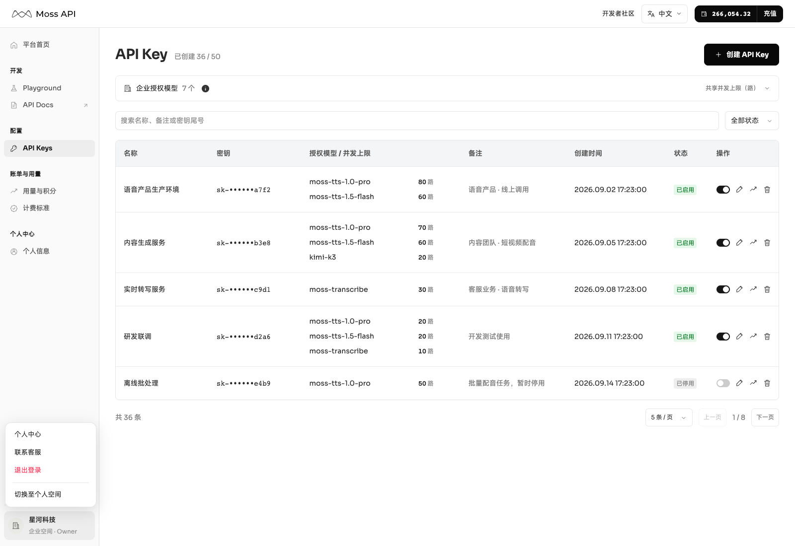

**个人 → 企业：** 点击左下角个人账户区域，选择“切换至星河科技”（正式环境显示可进入的企业名称）。返回企业后展示企业 Key、授权模型及并发上限。

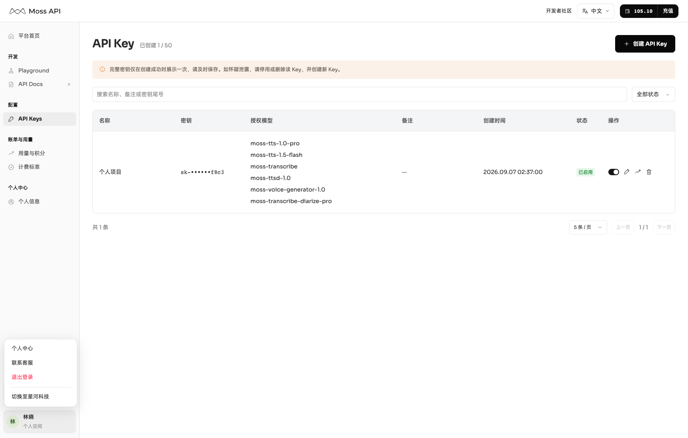

**切换后的规则：** 保留当前功能页面，按目标空间重新加载数据；关闭账户菜单及弹窗，清除未提交草稿、搜索、筛选、分页及 URL 查询条件。用量页面回到默认近 7 天、全部模型、全部 Key。已经保存的 Key、历史用量和积分仍归属原空间，不因切换而迁移或删除。仅展示用户有权进入的企业入口，切换空间不新增企业权限。刷新保留已选工作空间；切换用量空间后请求页码回到第 1 页，每页 10 条。

### 共用 UI 与交互

用量概览 / 请求明细切换时，白色选中背景平滑移动 220ms；鼠标和键盘切换均保留当前滚动位置，不自动回到顶部，也不因内容变短向上跳动。选中页签与内容面板保持无障碍关联；系统要求减少动态效果时取消动画。企业、个人设计稿按独立区域排布。

共用组件覆盖创建、编辑、启停、删除、一次性密钥、请求详情、账单预览、两种导出及积分弹窗。桌面统一 32px 内边距，窄屏 20px，标题、正文、操作区左右对齐；保留各类内容所需宽度与字号。滚动条由页面统一控制，静止时隐藏，滚动时立即显示；停止滚动 800ms 后，以 180ms 淡出。悬停或拖动滑块时保持可见，拖动结束后恢复自动隐藏。页面、横向表格、筛选菜单、授权模型列表、账单预览和导出明细共用此规则；不再因普通鼠标的系统设置而常显。原生滚动条宽 10px，滑块两侧各留 1px 透明边框，可见灰色部分约 8px；下拉菜单滑块宽 8px。滑块为 #808080，轨道透明，显示和隐藏不改变内容宽度或滚动位置；无溢出时不显示。保留原生滚轮、触控、键盘和拖动能力；减少动态效果时跳过淡出动画，高对比模式使用系统可见滚动条。表单与模型列表仅相邻行间分隔，最后一行无底线。

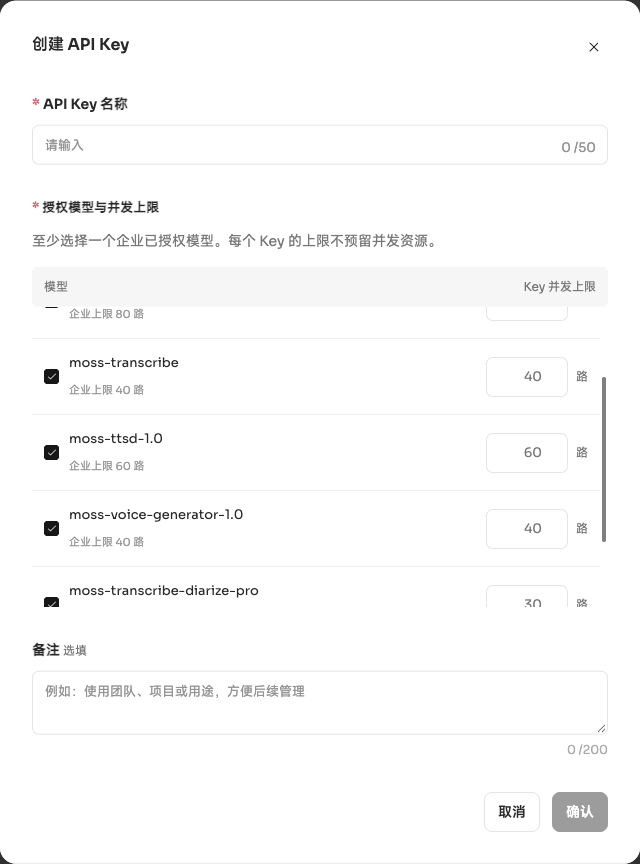

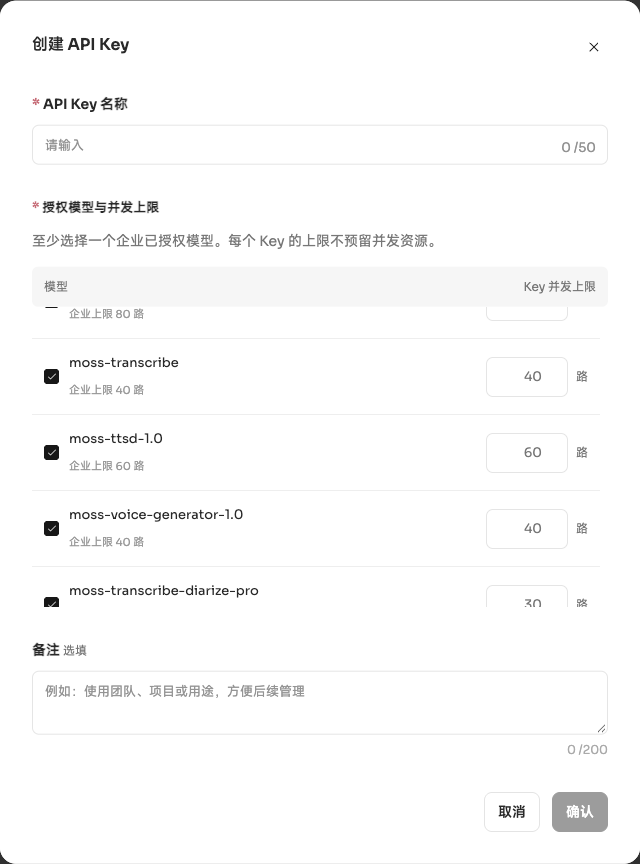

| 位置 | 统一 Info 文案 |
| --- | --- |
| Key 安全提示 | 企业 Key 列表不显示常驻橙色提示；创建成功弹窗保留“完整密钥仅此一次展示，关闭后无法再次查看，请妥善保存。”。个人列表保留原安全提示。 |
| 企业授权模型 | 同一模型的所有 Key 共享企业并发上限。Key 上限仅限制该 Key，不预留并发额度。 |
| 企业用量筛选 | 筛选条件同时用于用量、账单和明细导出。并发峰值仅随模型、Key 筛选变化，固定统计近 24 小时。 |
| 个人用量筛选 | 筛选条件同时用于用量、账单和明细导出。 |
| 并发峰值 | 近 24 小时的最高同时处理请求数 / 当前企业（指定 Key 时为 Key）并发上限。绿色低于 80%，橙色为 80% 至不足 100%，红色为达到或超过上限；不代表当前并发。 |
| 模型用量概览 | 请求次数仅统计实际扣除积分的请求，消耗积分已包含模型折扣。 |
| 请求明细导出 | 将导出当前筛选范围内的全部请求（含失败请求），不受页面分页影响。记录数见摘要。 |
| 企业支付 · 企业空间 | 当前企业已认证，请按合同约定付款 |
| 企业支付 · 个人空间 | 企业支付需完成企业认证~~并签署合同~~ |

| 项目 | 规则 | 验收点 |
| --- | --- | --- |
| 页面骨架 | 顶部品牌 / 余额，左侧导航，主区域标题与主操作、筛选、表格、分页 | 页面名称、浏览器标题与当前位置一致 |
| 字体与色彩 | 常规页面使用 Sora / MiSans；主文 #282828、次文 #777、普通表头 #555。账单预览、打印与导出明细共用 Inter / MiSans 文档模板，主文 #202b35、次文 #66737d、分隔线 #dce2e6、白底摘要；缩放字号、表格、合计和对齐规则一致。 | 各页面遵循对应样式，账单预览与打印同源 |
| 主操作 | 默认 #080808，hover #292929，禁用样式不可点击 | 创建、打印与下载共享样式 |
| 表格 | 文字左对齐、数值与表头右对齐；白底与细横线；模型类型使用 TTS / ASR 标签 | 概览 / 请求 / 导出间无对齐漂移 |
| 弹窗 | Reka 对话框；标题、内容、底部操作；焦点限制在弹窗，关闭返回触发按钮。充值、购买、获取积分与创建 Key 统一使用 rgba(0,0,0,0.8) 背景遮罩，个人充值与企业支付共用 | Tab、Esc、关闭、取消可操作；取消不保存 |
| 分页 | API Keys 默认每页 5 条，请求明细默认每页 10 条；均可选 5 / 10 / 20。筛选变化回第 1 页；页码不得越界 | 导出和汇总不随分页截断 |
| 动效 | 展开区和进度条轻量过渡；数字直接更新；遵循 reduced-motion | 筛选切换不出现虚构的滚动数值 |
| 窄屏 | 表格容器横向滚动，弹窗内滚动；个人模型卡片≤600px 时单列 | 内容可读、操作可触达、不截断必要字段 |

### API Keys：资源区、列表和操作

企业 · API Keys：授权模型与并发上限按 Key 管理；企业授权模型区域支持展开。

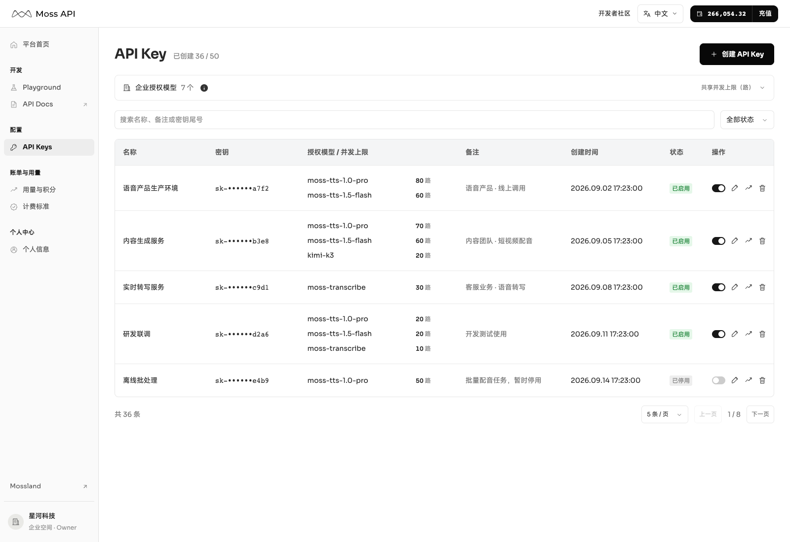

个人 · API Keys：展示授权模型列；个人 Key 仅配置模型范围。

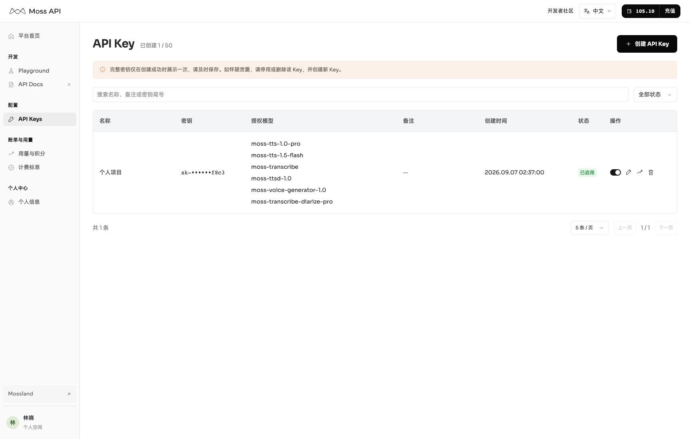

企业空间 API Keys 列表移除顶部橙色安全提示，创建成功弹窗保留完整密钥仅展示一次、及时保存的提示；个人空间继续保留列表安全提示。企业授权模型区和创建 / 编辑流程保持原有权限边界。

| 字段 / 控件 | 需求 |
| --- | --- |
| 搜索 | 匹配 Key 名称、备注或密钥尾号；与状态筛选共同生效 |
| 状态 | 全部状态 / 已启用 / 已停用 |
| 列表列序 | 名称、密钥、授权模型 / 并发上限（个人为授权模型）、备注、创建时间、状态、操作 |
| 授权列 | 逐项列模型名称；企业附该 Key 上限，个人仅显示名称 |
| 密钥 | 只展示掩码；列表不提供完整密钥恢复 |
| 操作 | 启停开关、编辑、查看用量、删除；名称也可打开编辑 |
| 查看用量 | 跳转 /app/usage 并将该 Key ID 写入筛选 URL |
| 空态 | 无 Key 引导创建；筛选无匹配提示调整条件；表头保留 |
| 额度 | 每空间最多 50 个未删除 Key，停用计入，删除释放名额 |

#### 创建与编辑

企业 · 创建 API Key：模型列表包含 kimi-k3（企业上限 20 路），列表独立滚动，名称、备注与底部操作保持可见。滚动时显示滚动条，停止 800ms 后以 180ms 淡出；悬停或拖动滑块时保持显示，轨道透明，不预留常驻滚动条空槽。下图为最新正式版本的静止状态。授权模型至少选一项，新增模型不自动改写已有 Key 授权。

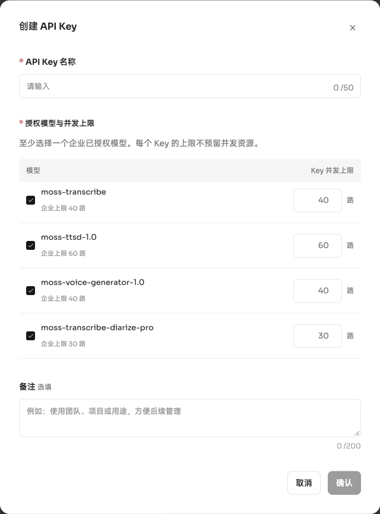

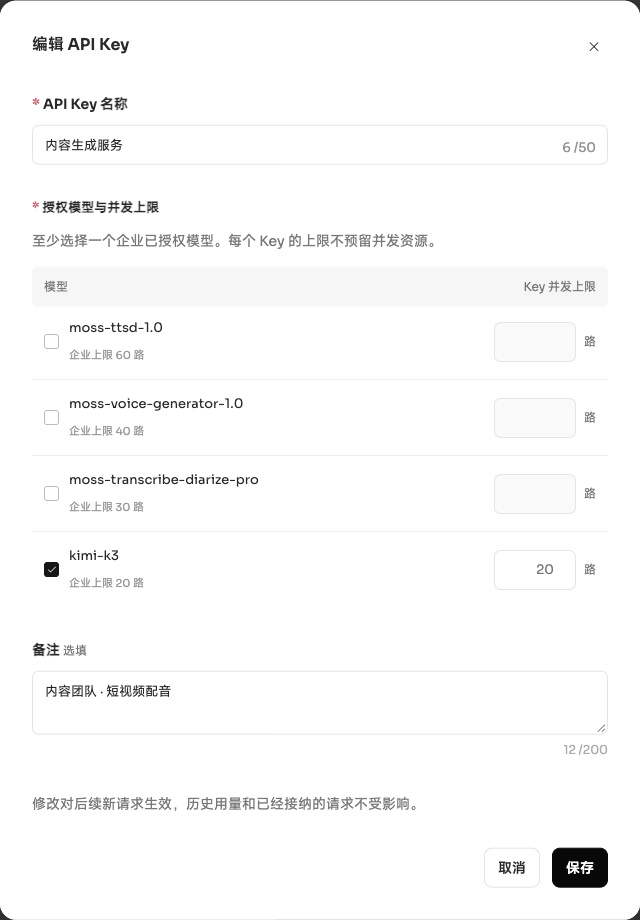

个人 · 创建 API Key：授权模型采用两列布局，至少选择一个模型。

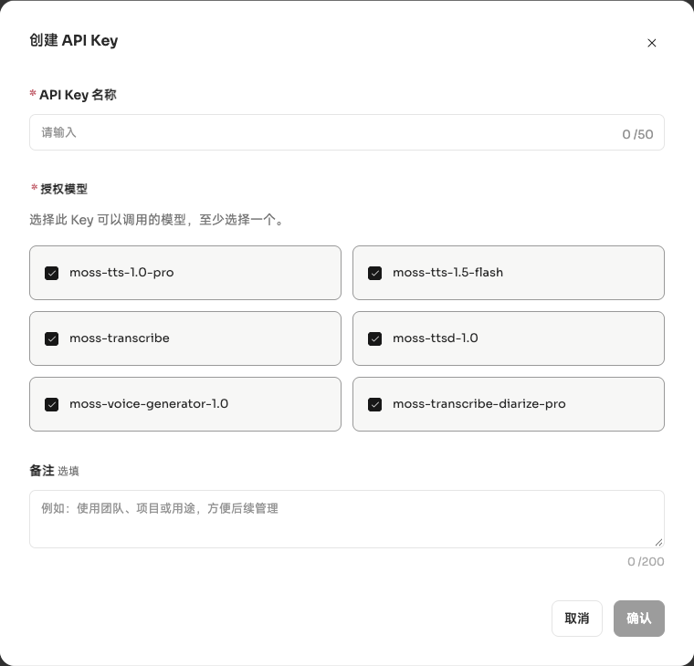

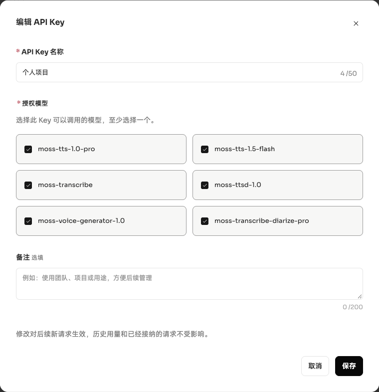

创建流程：按空间类型进行授权与参数校验，成功后仅展示一次完整密钥。

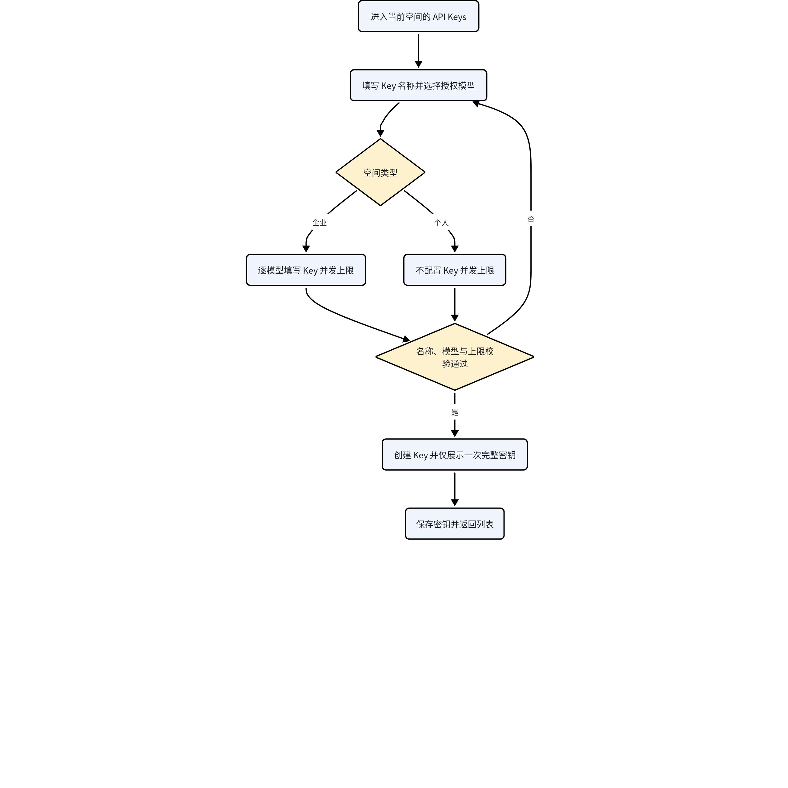

[可编辑 Mermaid 源码](assets/20260915/create.mmd)

| 字段 | 校验与默认值 | 反馈 |
| --- | --- | --- |
| API Key 名称 | 必填，去首尾空格后 1–50 字符 | 长度计数；不满足时不可提交 |
| 授权模型 | 至少一个；新建默认全选当前可用模型，编辑恢复已保存范围 | 企业与个人的创建 / 编辑表单取消全部模型后，立即在模型列表下显示红字“请至少选择一个授权模型。”，确认 / 保存保持禁用；重新勾选至少一个模型后提示消失，其他字段也有效时允许提交。错误说明与授权模型字段组关联，供辅助技术读取。 |
| 企业每模型 Key 上限 | 必填整数；范围 1 至企业该模型上限；默认企业上限 | 取消模型勾选后输入禁用；超限 / 非整数行内错误 |
| 个人模型选择 | 两列勾选卡片；只选择范围 | 无需并发输入；保存后列表及重新编辑显示相同范围 |
| 备注 | 选填，最多 200 字符；说明项目、团队或用途 | 字符计数；原样归属当前 Key |

企业授权模型空选状态（2026-10-17 线上实测）：名称已填写，取消全部七个模型后，各模型并发输入禁用，列表下方显示“请至少选择一个授权模型。”，确认按钮禁用。下图为同一弹窗模型列表顶部和底部；名称输入框聚焦时无深色外圈，列表末行无多余分隔线。取消后未创建 Key。

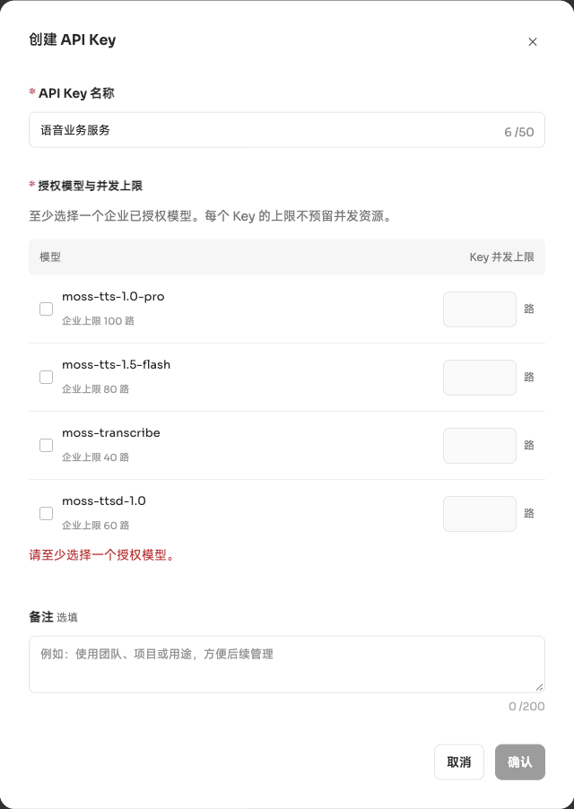

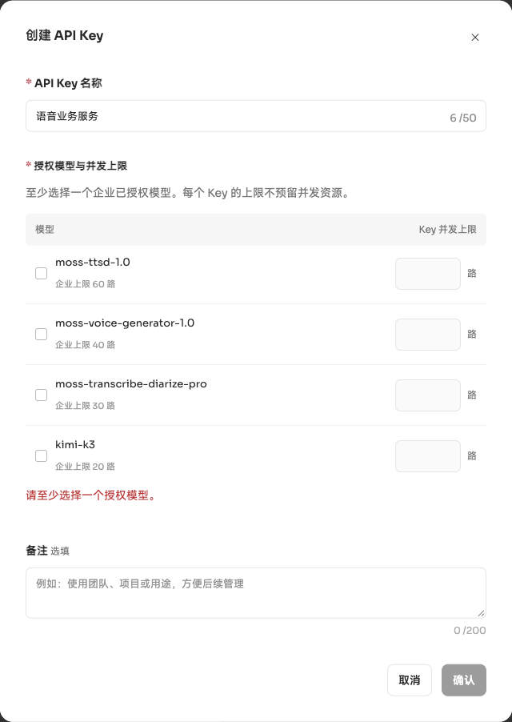

[查看企业未选择模型设计状态](https://www.figma.com/design/uKJHefil0SBm8xMnc37NnE?node-id=107-1178)

创建提交期间防止重复操作；失败保留表单并显示错误。成功进入持续存在的密钥结果弹窗，完整密钥仅此一次展示；支持复制和手动选中，复制失败提示手动复制。用户关闭后只能看到掩码。原型中的 sk-prototype 示例不可用于真实服务。

编辑保存不改变 Key 字符串；取消不保存。模型范围、企业 Key 上限和备注对后续请求生效，不改写已发生用量。

#### Key 生命周期

Key 生命周期：启用、停用可切换；删除后保留历史计量归因。

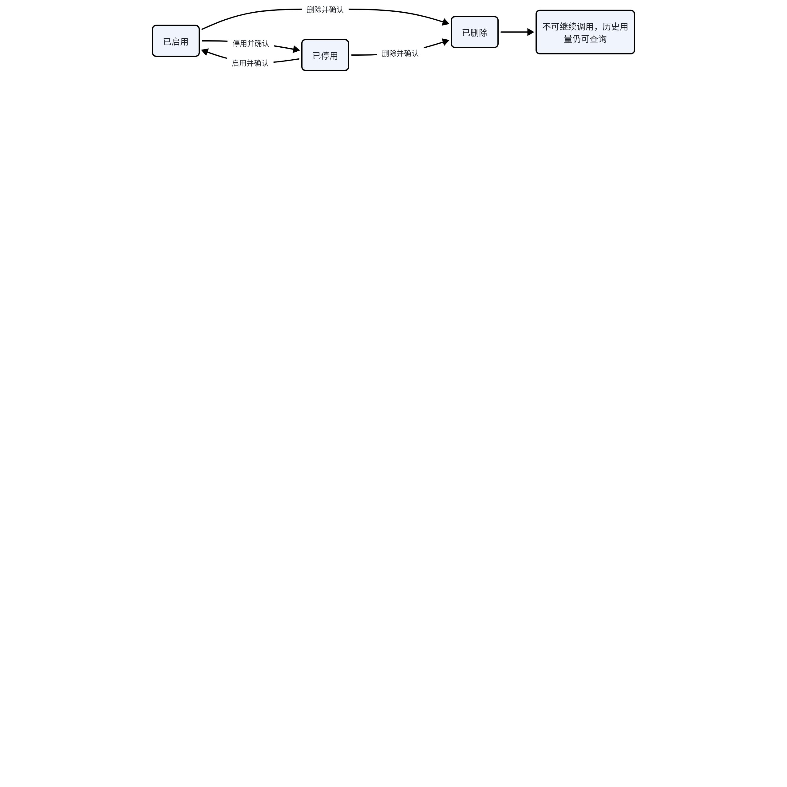

[可编辑 Mermaid 源码](assets/20260915/lifecycle.mmd)

| 操作 | 确认内容 | 成功结果 / 历史处理 |
| --- | --- | --- |
| 停用 | 后续新请求被拒绝，已接纳请求可完成 | Key 标记已停用，支持再次启用 |
| 启用 | 按当前模型范围和有效上限接纳新请求 | Key 标记已启用 |
| 删除 | 永久撤销，无法恢复；历史用量和账单保留 | 活动列表移除并释放名额；历史筛选保留稳定 Key ID 与状态 |
| 保存失败 | 显示服务端原因并保留输入 | 不得提前更改列表或显示成功 |
| 复制失败 | 提示手动选中复制 | 保留一次性结果弹窗，不能假报复制成功 |

### 模型授权、共享并发与峰值

企业模型并发接纳与释放流程。Key 上限不预留企业共享额度。

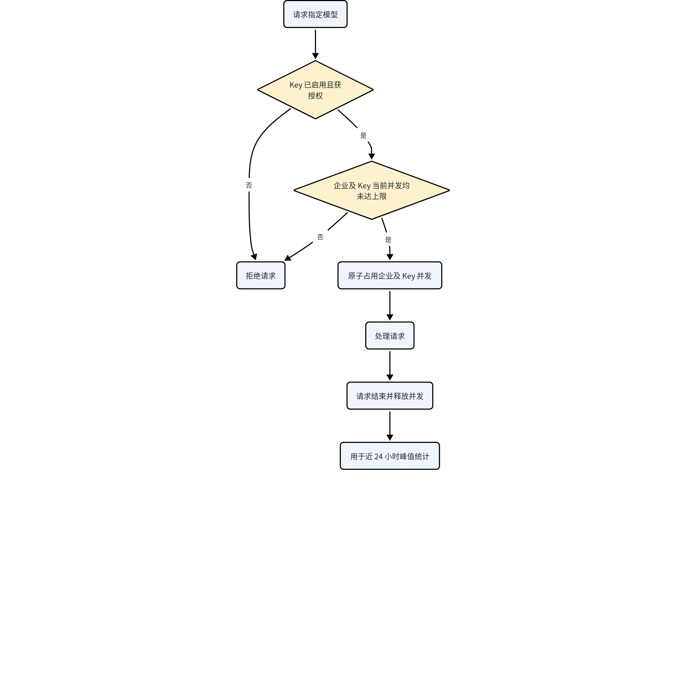

[可编辑 Mermaid 源码](assets/20260915/concurrency.mmd)

近 24 小时峰值除以当前上限：低于 80% 绿色 #7aa286；80% 至不足 100% 橙色 #dd954d；达到上限红色 #b96154，并配文字。零值显示空进度条。企业七模型均纳入监测示例，包括 kimi-k3 7/20；长名称单行省略并可查看全名。按当前分钟生成在途请求区间，按重叠计算，不相加各 Key 的历史峰值；账单日期筛选不改变该窗口。样例监测不参与计费，生产值由监测服务返回。

同一企业、同一模型共享一个并发池。每把企业 Key 可配置自身模型上限，单项不得大于企业上限，各 Key 上限之和允许大于企业上限。Key 上限不预留资源。

示例：企业某模型上限 100 路，两把 Key 各设 80 路。当第一把正在处理 70 路时，第二把最多还能接纳 30 路。企业峰值按同一时刻所有 Key 在途数计算，不能相加各 Key 各自的历史峰值。

新请求必须同时满足模型授权、Key 启用、企业与 Key 两级并发限制。达到任一上限后直接拒绝，不排队；已接纳请求可完成，完成 / 失败 / 超时 / 取消均幂等释放。模型撤权或企业上限降低时按当前有效配置判断新请求，历史统计保留原值。

| 查询组合 | 企业并发卡片 |
| --- | --- |
| 全部模型 + 全部 Key | 每个模型企业峰值 / 当前企业上限 |
| 指定模型 + 全部 Key | 该模型企业峰值 / 当前企业上限 |
| 全部模型 + 指定 Key | 此 Key 各模型峰值 / 对应 Key 上限 |
| 指定模型 + 指定 Key | 此 Key 在该模型的峰值 / Key 上限 |

卡片窗口固定滚动近 24 小时，不随账单日期改变；模型与 Key 筛选生效。显示更新时间；历史峰值超过当前下调后的上限时不得截断。个人用量页不展示该卡片。原型按分钟更新展示时钟；生产服务返回权威峰值及统计时刻。

### 用量与积分：筛选、概览与请求

#### 模型与 API Key 多选规则

适用于企业与个人用量页面。模型 A、B 与 Key 1、2 同时选中时，只返回指定时间内由 Key 1 或 2 调用模型 A 或 B 的计费请求。

| 状态 / 操作 | 显示与行为 |
| --- | --- |
| 默认 / 点击“全部” | 只勾选“全部模型 / 全部 Key”，具体项不勾选；表示不限制这一类条件。点击“全部”清除显式选择。 |
| 从“全部”点一个具体项 | 进入单选状态：只勾选该项，取消“全部”的勾选。顶部按钮显示该项名称。 |
| 继续添加 / 取消具体项 | 可多选；菜单保持打开，选中项显示对勾和背景。部分多选时按钮显示“已选 N 个模型 / Key”。 |
| 取消最后一个具体项 | 自动恢复“全部”，不产生空选择结果。 |
| 逐项选满所有可选项 | 具体项保留勾选，“全部”菜单行不勾选；顶部按钮显示“全部模型 / 全部 Key”。此时取消一项，其余项保持选中。 |
| 模型和 Key 同时筛选 | 同类选择取并集，日期、模型、Key 之间取交集；不修改 Key 授权或并发配置。 |
| 筛选变化 / 刷新 | 请求页码回到第 1 页；URL 用重复 model / key 参数保存多项，刷新恢复。概览、明细、账单和导出使用同一筛选范围。 |
| Key 长名称 | 菜单中单行、中间省略，保留名称首尾、Key 尾号及停用 / 删除状态；悬停可看全文。保存和筛选仍使用完整 Key ID。 |

下拉按钮：不限制或逐项选满显示“全部模型 / 全部 Key”；只选一项显示该项名称；部分多选显示“已选 N 个模型 / Key”。重复 URL 参数保存各选择，刷新可恢复。企业标准 mock 有 36 个 Key，新增的 30 个关联实际 mock 请求以验证筛选和明细。账本 v6 将现有企业请求按创建时间及授权模型稳定分配，不新增消耗、不改变结算快照；旧缓存保留改名、启停和删除状态。零用量 Key 不生成虚假明细；全量一致性检查及待修问题见《Mock数据一致性核对-20261017.md》。

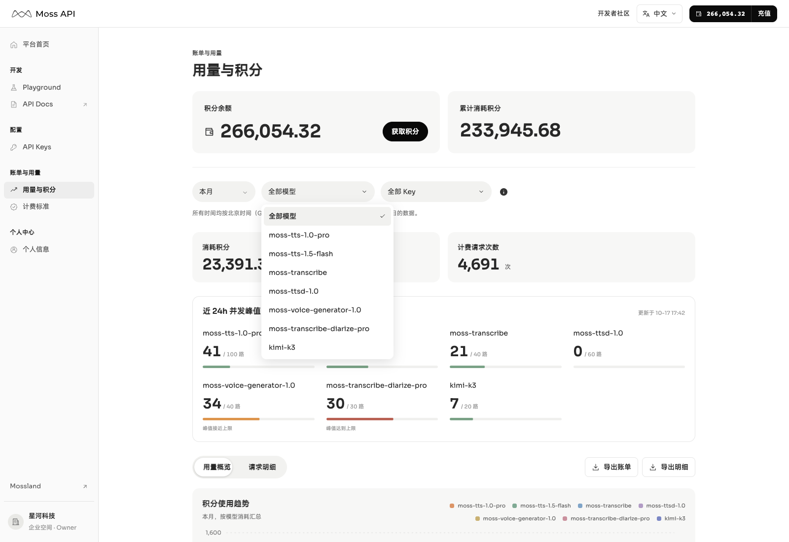

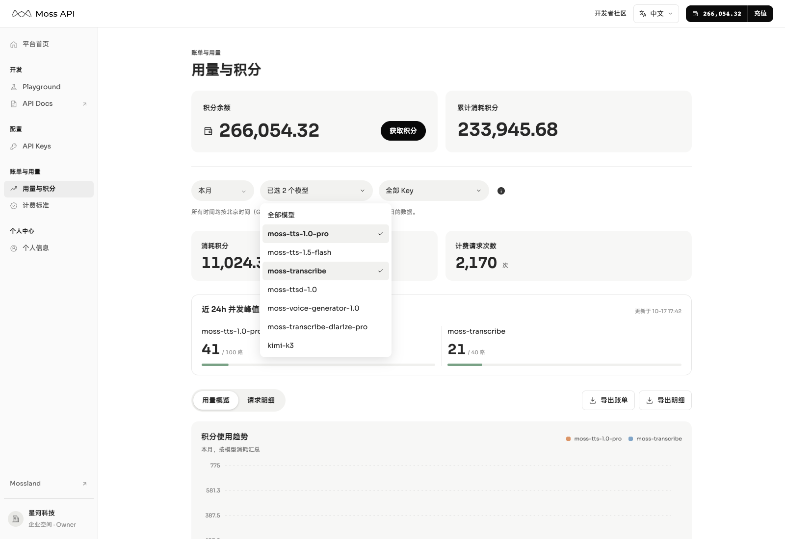

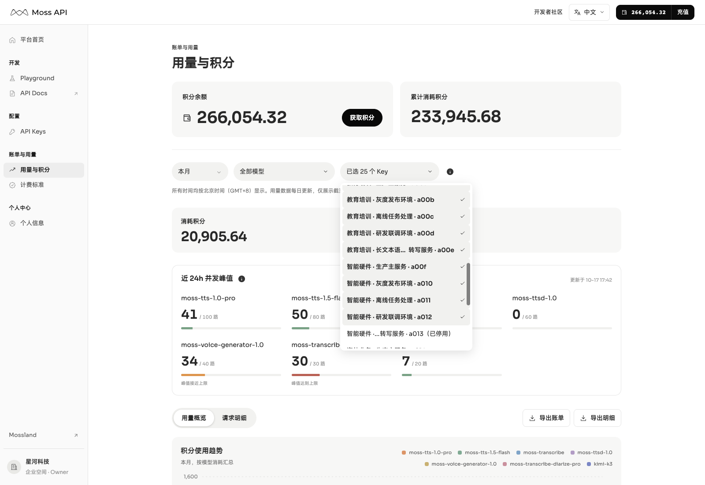

企业 · 用量概览：积分、计费请求统计及近 24 小时并发峰值。

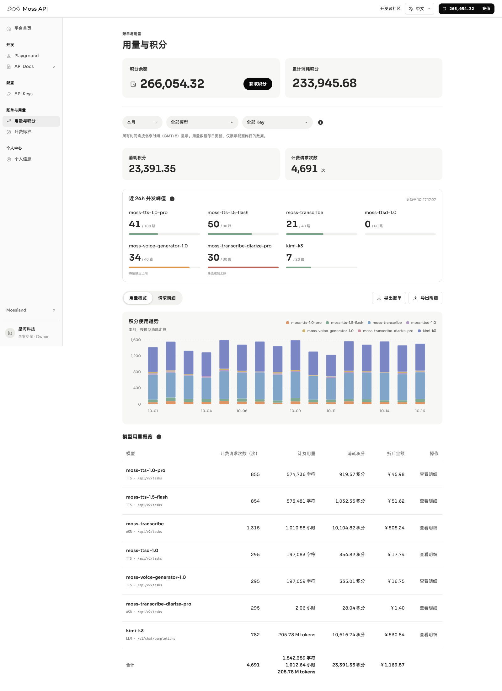

个人 · 用量概览：保留积分、计费请求统计，不展示企业并发卡片。

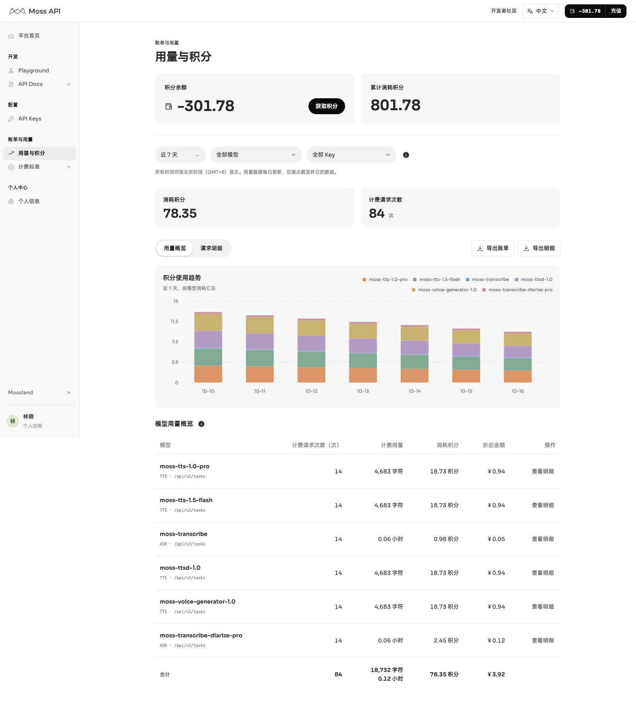

请求明细：与用量概览共用时间、模型、API Key 筛选；列出全部已同步请求，包括零扣费失败请求。状态用绿点“成功”和红点“失败”表达。

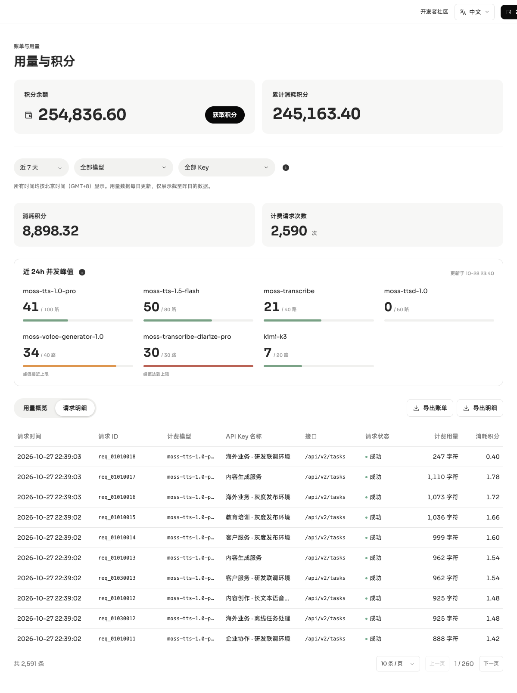

请求详情：点击请求 ID 打开，按固定顺序展示 12 个字段。标签和值均为单行，超长值省略并保留悬停全文；无复制按钮。

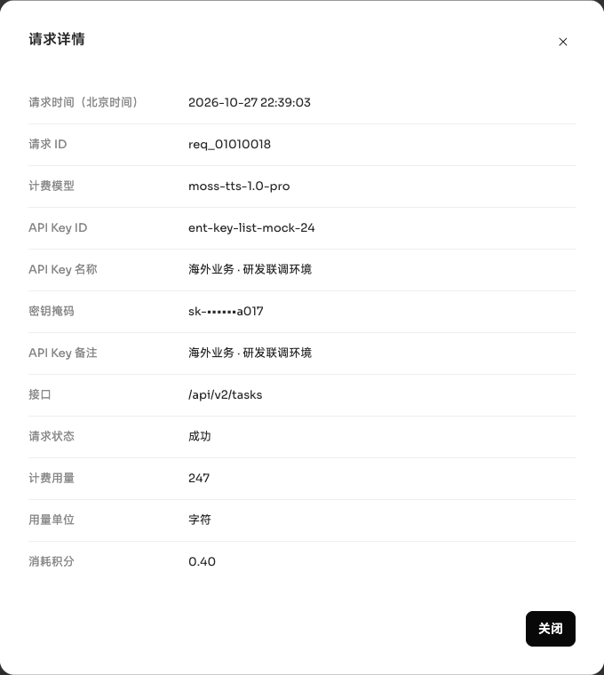

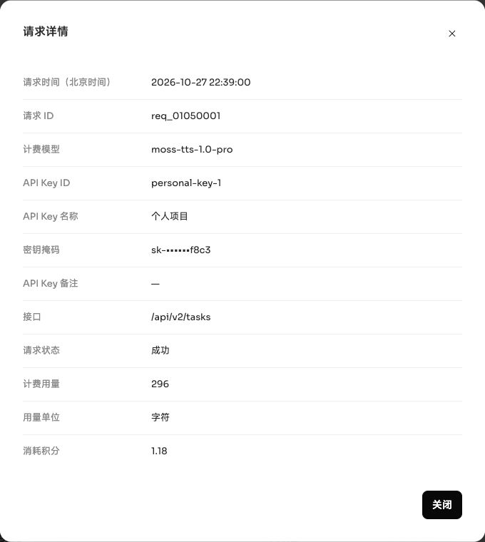

布局顺序：账户积分余额 / 累计消耗 → 时间 / 模型 / Key 筛选 → 所选范围消耗积分 / 计费请求次数 → 企业并发区 → 用量概览 / 请求明细。账户总余额和累计消耗不受筛选影响；其他计费模块使用同一筛选范围。

| 筛选 / 数据 | 规则 |
| --- | --- |
| 时间范围 | 北京时间自然日，起止日期均包含；近 7 天截至昨日 |
| 本月 | 当前月份 1 日至昨日；每月 1 日显示“本月暂无已同步数据”，不得返回上个月 |
| 自定义 | 开始≤结束、截止≤北京时间昨日；旧链接含未来截止日时截到昨日，纯未来区间恢复近七天。未来演示数据不展示为已结算数据。 |
| 模型 / Key | 模型与 Key 均支持多选，具体状态规则见本节开头“多选的含义”。同类取并集，模型与 Key 及时间取交集；不限条件时只勾选“全部”，不同时勾选具体项。历史已删除 Key 仍可查询并标记状态。 |
| 同步 | 按日同步、通常次日完成；明确展示已同步口径，不把待同步当真实零 |
| URL | 用量 URL 保存时间预设、自定义起止、重复 model / key 参数、页签和分页；刷新恢复全部选择，条件变化回第一页，非法或越权条件归一化。 |
| 计费请求 | 仅实际扣除积分（积分>0）的请求；失败是否扣费以实际计量结果为准 |
| 无数据 | 图表与表格按各自统计范围显示空态。没有计费请求时禁用导出账单；没有请求记录时禁用导出明细。仅有零扣费失败请求时，仍可导出请求明细。 |

当前 mock 账本为 v9。在 v8 历史结算快照上补入一条 2026-10-27 21:53:00 的失败请求：0 秒、0.00 积分，可筛选、可查看详情、可逐请求导出；重复加载不新增第二条。历史请求、结算金额及阶梯快照保持一致。概览、账单和模型与 Key 汇总只统计消耗积分大于 0 的计费请求；请求明细与逐请求 CSV 记录全部已同步请求。

用量概览按模型展示堆叠积分趋势及模型汇总。Kimi 使用柔和靛蓝 #7b87c5，其余模型采用区分清晰的低饱和配色。概览模型列占 26% 并保留必要最小宽度，数值和表头右对齐。TTS 为字符、ASR 为两位小数小时、Kimi 为两位小数 M tokens；合计按单位分别显示。请求详情与 CSV 保留字符、秒、tokens 原始单位，不用展示舍入值反算历史金额。

“请求明细”主表每个请求一行，8 列依次为：请求时间、请求 ID、计费模型、API Key 名称、接口、请求状态、计费用量、消耗积分。计费用量将数值与原始单位合并展示（字符、秒、tokens）；用量和积分右对齐。页面最大宽度 1200px，侧栏右侧居中；表格最小宽度 1100px，窄屏在容器内横向滚动。列宽依次为 184 / 160 / 136 / 剩余空间（至少 148）/ 140 / 88 / 152 / 92px。单元格左右内边距 12px，首尾外侧 8px，表头与内容对齐。全部单行；请求 ID 中间截断为“req_led … ribe_195”，省略号两侧留空格；模型和接口在末尾截断为“/v1/chat/compl…”，省略号前不加空格。长名称正常末尾省略，悬停可看全文。请求 ID 作为详情入口，无复制按钮。详情弹窗宽 680px，标签列 160px、列间距 20px；12 个字段依次为：请求时间（北京时间）、请求 ID、计费模型、API Key ID、API Key 名称、密钥掩码、API Key 备注、接口、请求状态、计费用量、用量单位、消耗积分。密钥始终掩码显示，空备注为“—”。主表和详情均不展示折算金额或结算单价。最后一行无底部分隔线；正文超高时内部滚动。模型下钻保留时间和 Key 条件。

用量概览的金额列统一为“折算金额”，按 1 积分 = 0.05 元计算；页面金额保留两位小数。

### 账单预览与 PDF 打印

PDF 默认文件名采用“用量账单 — Moss API（账户名称）— 账期.pdf”。企业使用公司名，个人使用“用户名 · 用户 ID”；同月区间使用“2026年9月”格式，跨月使用“2026-09-01 至 2026-10-31”格式。例如“用量账单 — Moss API（星河科技）— 2026年9月.pdf”。预览打开时设置对应页面标题，关闭后恢复原标题；最终保存文件名可在浏览器保存框中修改。

2026-10-17 / 03 更新企业本月三档账单与个人近 7 天账单截图，来自生产基线 d45da85；新增用量按日分布截图，并同步调用明细与两种导出。下方未替换的 25 个 Key 筛选示例、实际 PDF 渲染图保留 2026-10-16 图注，用于历史版式验收，不作为当前费率或本月金额依据。

账单按模型及已结算规则汇总；相同模型、相同单价与门槛的数据合并，不因来自旧数据或新 mock 而重复生成模型行。不同历史费率在同一模型组内保留。企业抬头使用企业名称，个人使用“用户名 · 用户 ID”。预览与打印共用正文；屏幕预览随内容收拢，打印保持 A4 横向纸张尺寸。

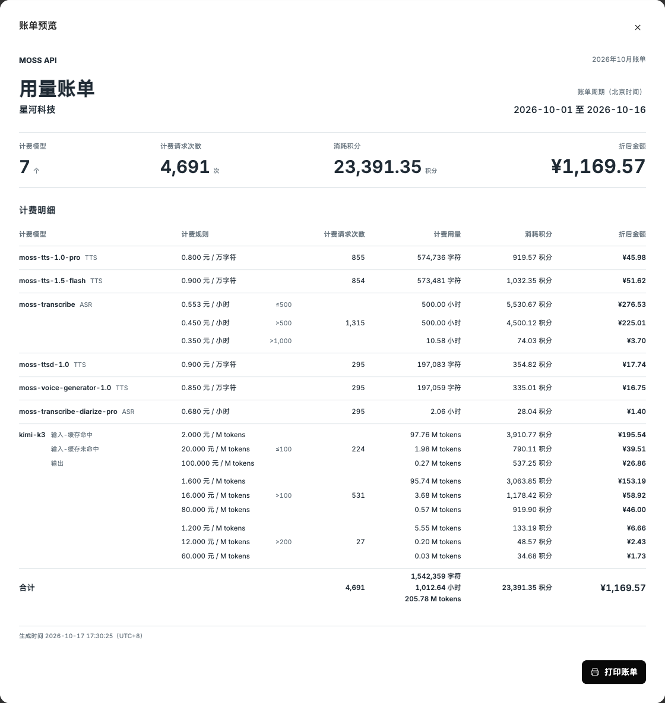

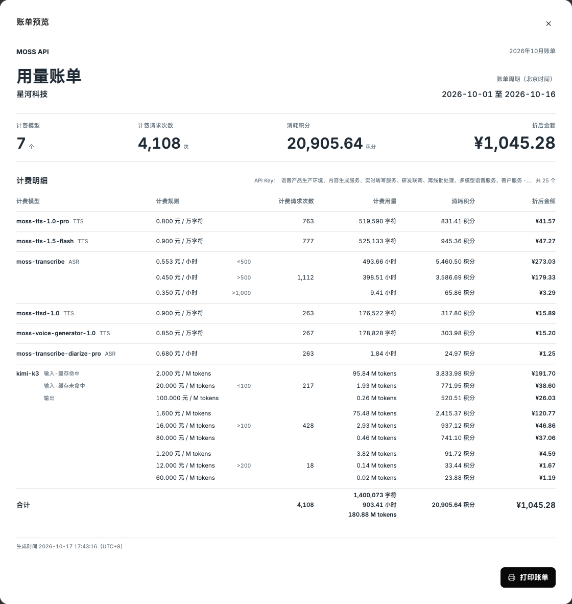

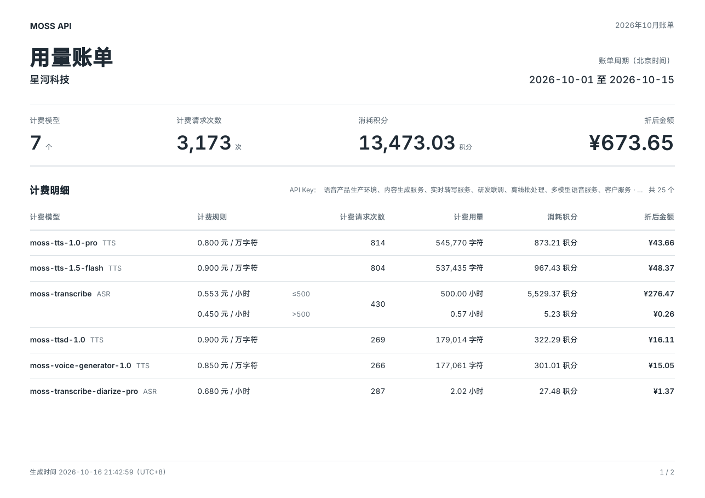

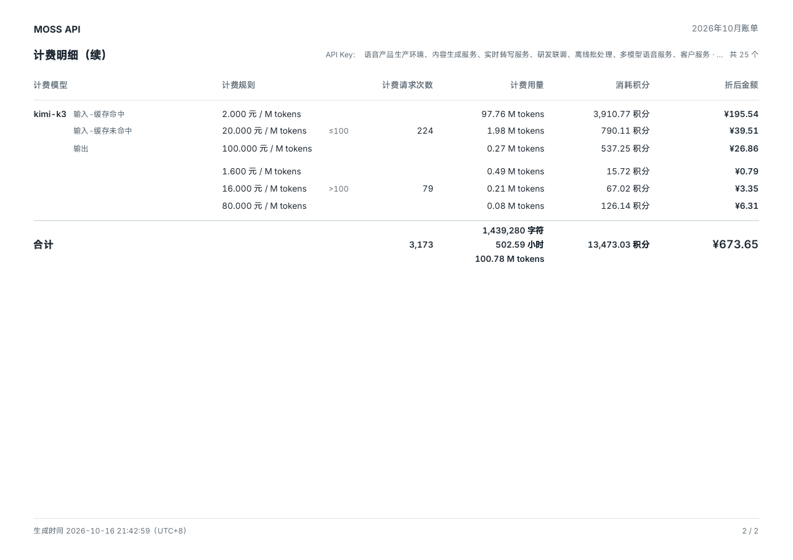

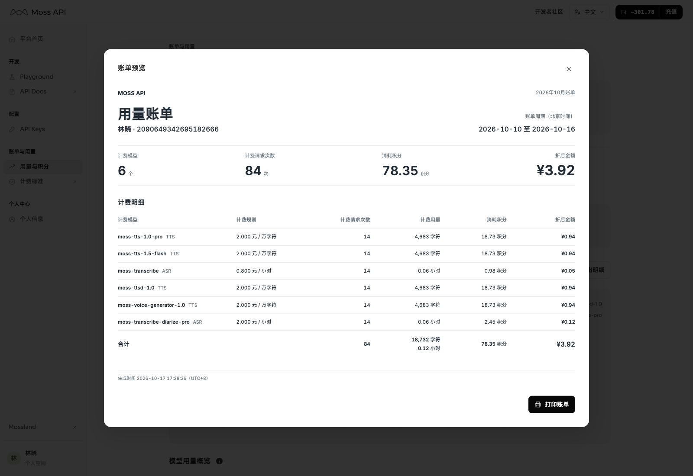

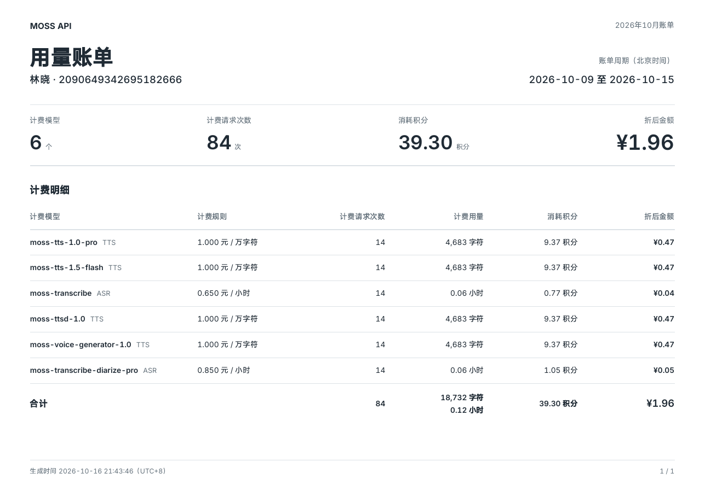

账单与 CSV 共用计费请求范围；分页不影响导出。

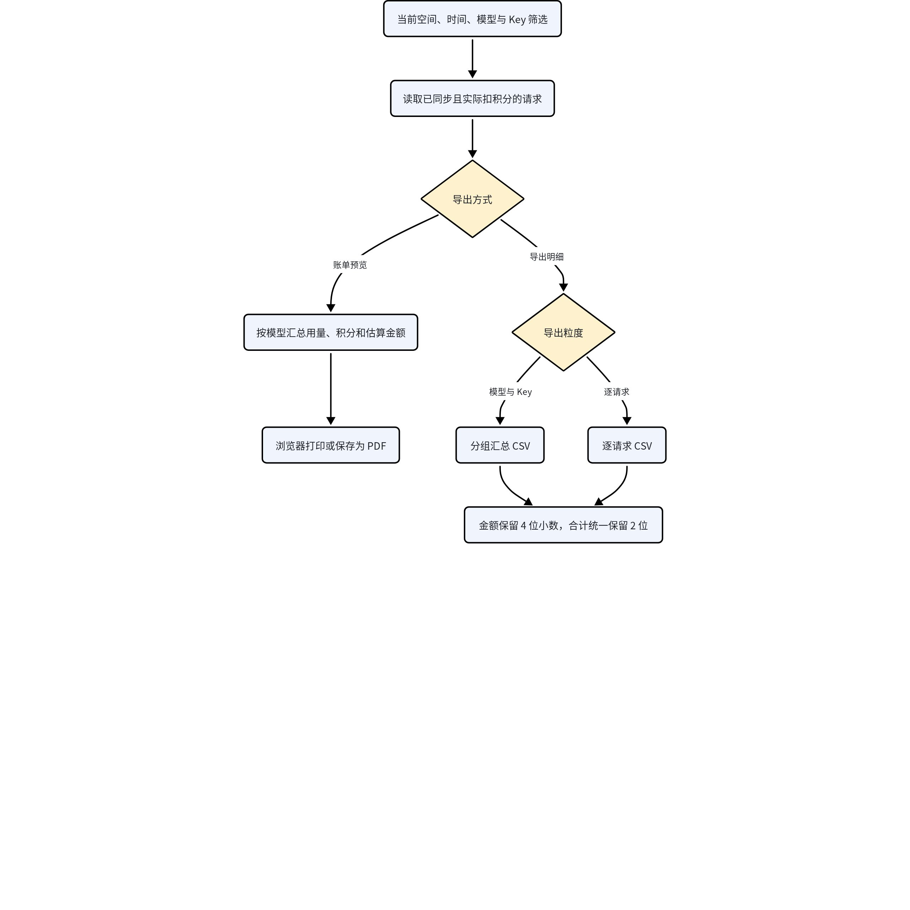

[可编辑 Mermaid 源码](assets/20260915/export.mmd)

入口“导出账单”，弹窗名“账单预览”。顶部为 MOSS API、账期、标题、账户与北京时间起止日期；摘要为计费模型、计费请求次数、消耗积分、折后金额。

#### 账单中的 API Key 显示规则

| 状态 / 操作 | 显示与行为 |
| --- | --- |
| 全部 Key / 逐项选满 | 隐藏整条 API Key 摘要，账单上不显示“全部 Key”占位文字。 |
| 只选一个 Key | 在“计费明细”标题右侧显示“API Key：名称 共 1 个”。 |
| 选择部分多个 Key | 同一位置显示“API Key：名称列表 … 共 N 个”；名称列表只占一行，超长在末尾省略，总数独立保留且不截断。 |
| N 的计数 | 按选中的唯一 Key ID 数量计算，包括当前日期内无用量的已选 Key；不按可见名称数量、有用量 Key 数量或账单行数计算。 |
| 空间与样式 | 右侧摘要最多占标题行 70%，上限 460 个账单模板单位；企业与个人共用规则。这里是末尾省略，与下拉菜单的中间省略不同。 |
| 模型筛选 | 账单不展示模型范围，也不增加“筛选范围”标题；模型筛选仍决定实际账单内容和合计。 |
| 预览、打印与导出 | 预览悬停可看完整 Key 名单；打印保留单行省略和总数，续页重复摘要。两种导出明细使用相同摘要；CSV 保留完整名称和稳定 Key ID。显示省略不改变金额或数据范围。 |

| 区块 | 字段 / 行为 |
| --- | --- |
| 表格 | 计费模型（附类型标签）、计费规则、计费请求次数、计费用量、消耗积分、折后金额 |
| 计费规则 | 实际发生的费用采用结算快照，不按当前价重算；缺失档位以合同单价补齐零用量展示。单价左对齐；灰色门槛统一在单价后右对齐且不换行，ASR 按 ≤500、>500、>1,000，Kimi 按 ≤100、>100、>200 排列，不加括号或重复单位。Kimi 每档三行，输入-缓存命中、输入-缓存未命中、输出标签仅在首档显示一次，后续保留对应留白；各档门槛与请求次数居中。 |
| 合计 | 合计仅在最后一页展示，统计筛选全量计费请求、各单位用量、积分及金额。Kimi 请求按档位汇总一次，不因拆成输入、输出三行而重复；分页不影响合计或 CSV。 |
| 金额 | 金额估算 = 当前筛选范围内的消耗积分 × 参考换算率。参考换算率来自基础积分包：20 元 ÷ 400 积分 = 0.05 元 / 积分。消耗积分已包含模型折扣，不再次乘折扣；该金额仅供展示参考，不代表实际支付金额或实际成本。 |
| 打印 | 浏览器打印 A4 横向，仅输出正文。按纸张宽度实测内容高度，以完整模型组分页；补齐三档后行数增加，页数可随内容自然增加。放得下则一页，放不下自然分页，不为凑一页缩字号或改变模板。续页保留 MOSS API、账期、表头、“计费明细（续）”；页末模型无多余底线，页脚含生成时间与页码。 |
| 版式 | Inter / MiSans，842 × 595 模板单位：正文 9、行距 15、普通行高 30、模型组上下 padding 7.5、组内三行间距 3.5、阶梯间距 9；打印左右边距 36、上下 24。ASR 与 Kimi 共用阶梯间距，不添加内部阶梯横线。摘要、表头、模型边界、合计、页脚横线统一 0.75 单位及 #dce2e6。API Key 摘要字号 8、行高 12、#66737d；标签、名称和总数字重 400，与页脚辅助文字一致。屏幕预览随内容收拢，弹窗保留 32px 内边距；打印页脚置底；API Key 摘要位于明细标题右侧，分页测量包含整行高度。 |

Figma 打印画板：[企业](https://www.figma.com/design/uKJHefil0SBm8xMnc37NnE?node-id=171-1100)、[个人](https://www.figma.com/design/uKJHefil0SBm8xMnc37NnE?node-id=174-1100)。以上为 2026-09-15 历史画板，本次未更新 Figma；2026-10-15 账单模板以本文规则及本次发布实现为准，使用 Inter / MiSans。画板内的日期与数值仅为演示样例。

PDF 页面金额保留 2 位小数。打印内容与预览同源；在目标浏览器检查文字、表头、分页和合计完整性，不以屏幕弹窗能完整显示替代实际 PDF 验收。

近 7 天 Kimi 线上验收截图（2026-10-17）：

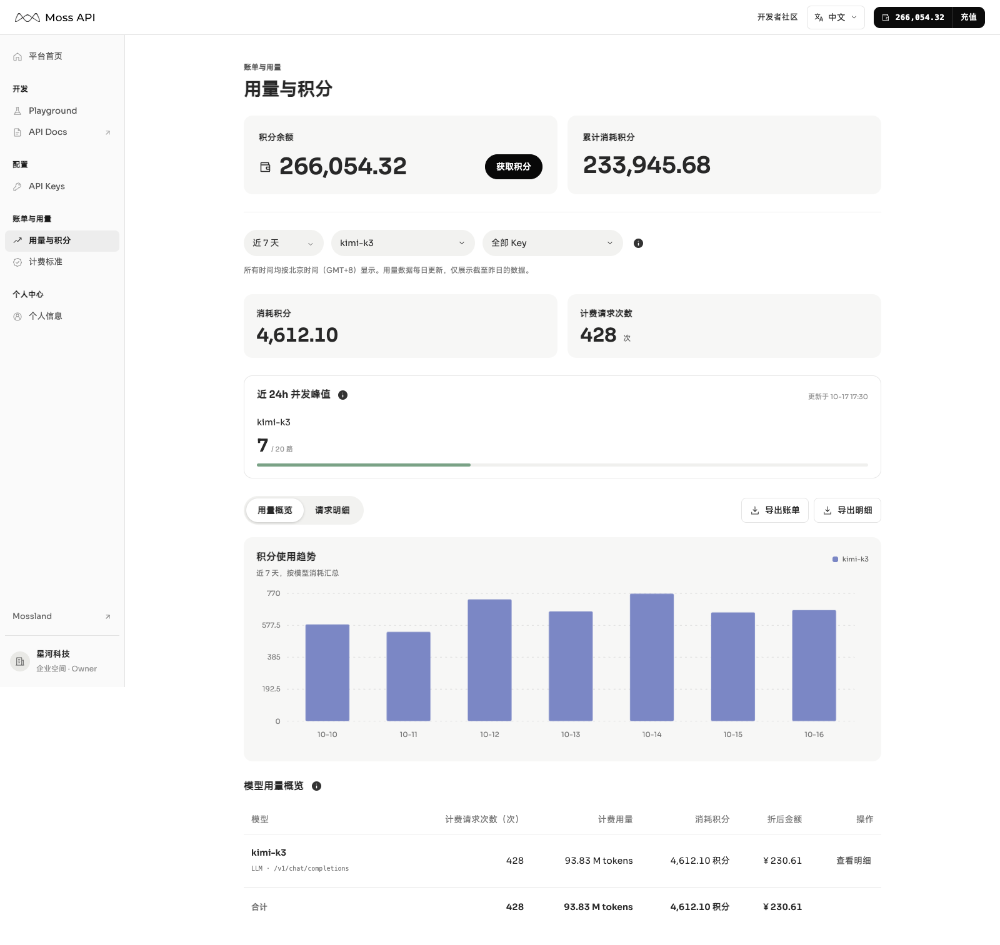

#### 分段累进与样例数据

2026-10-17 本轮 mock：账本 v8 在企业 10 月 1–16 日分散 Kimi 与基础转写请求，按日保留适度起伏，不把跨档用量集中在一天。本月截至 10 月 16 日包含全部三档；各请求用量、扣费与阶梯快照保留，按时间排序维持分段累进顺序。已有 v7 缓存自动迁移，重复刷新不重复生成；个人、9 月历史和 11 月快照不重算。请求 ID 为稳定标识，部分历史 mock ID 含原生成日期，应以时间列为准，不解析 ID 推断请求日期。

Kimi 按自然月输入（缓存命中、缓存未命中）及输出总 tokens 分段累进，各段使用对应分项单价；筛选只聚合既有结算快照，不重置阶梯。

| 月度总 token 档位（M） | 区间 | 命中 / 未命中 / 输出单价（元 / M tokens） |
| --- | --- | --- |
| ≤100 | 首个 100 M | 2 / 20 / 100 |
| >100 | 100 M 至 200 M | 1.6 / 16 / 80 |
| >200 | 超过 200 M | 1.2 / 12 / 60 |

ASR moss-transcribe 按 ≤500、>500、>1,000 小时依次展示三档，单价为 0.553 / 0.450 / 0.350 元每小时；Kimi 按 ≤100、>100、>200 M tokens 依次展示三档。当前筛选范围内出现的阶梯模型，账单预览与打印均补齐完整三档，即使只有首档或只有较高档产生用量也不隐藏其他档位。缺失档位的计费用量、积分与金额显示 0；Kimi 缺失档位的请求次数显示 0，ASR 请求次数仍按模型汇总。已有结算快照和实际单价保留，补齐项取同一合同配置，不重算历史费用、不修改请求记录或 CSV。无请求的模型不额外加入账单，个人普通单价账单不套用企业阶梯。

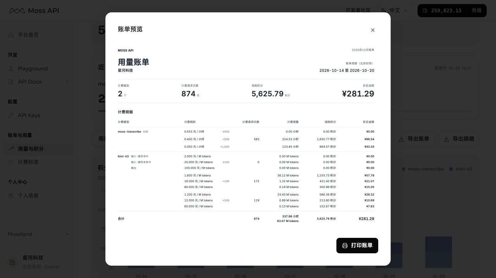

本月截至 10 月 16 日共 4,691 次、23,391.35 积分；Kimi 205.78 M tokens、基础转写 1,010.58 小时，均包含三档。近 7 天按实际结算档位汇总，Kimi 为 428 次、93.83 M tokens、4,612.10 积分。调整日分布保留逐请求快照，实际时间以时间列为准。

### 导出明细与 CSV

2026-10-26 正式发布：两种导出名称、折算金额和文件名时间规则已同步；额外新增的底部说明已删除，概览提示恢复原样。以下为正式站点截图。

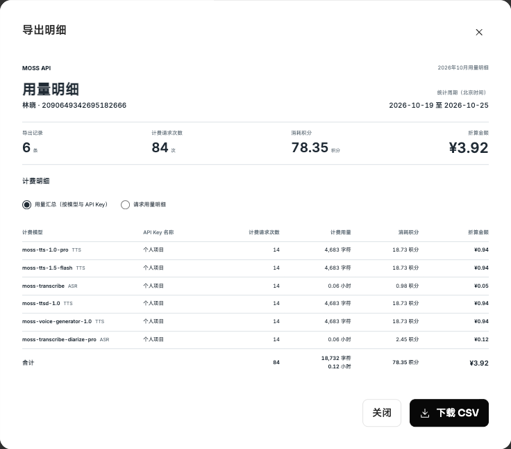

导出明细 · 用量汇总（按模型与 API Key）：摘要按导出记录、计费请求次数、消耗积分、折算金额排列。

导出汇总表的 API Key 名称固定单行显示，超出列宽时在末尾显示省略号（…），悬停可查看完整名称；不换行撑高行高。CSV 保留完整名称。

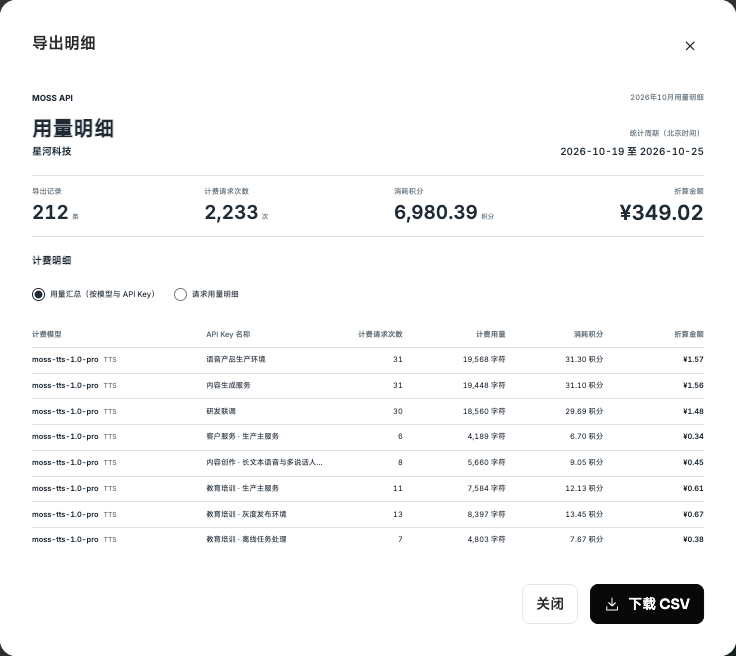

以下 2026-10-17 截图为历史版式记录；当前名称、字段和说明以本节 2026-10-26 规则为准。

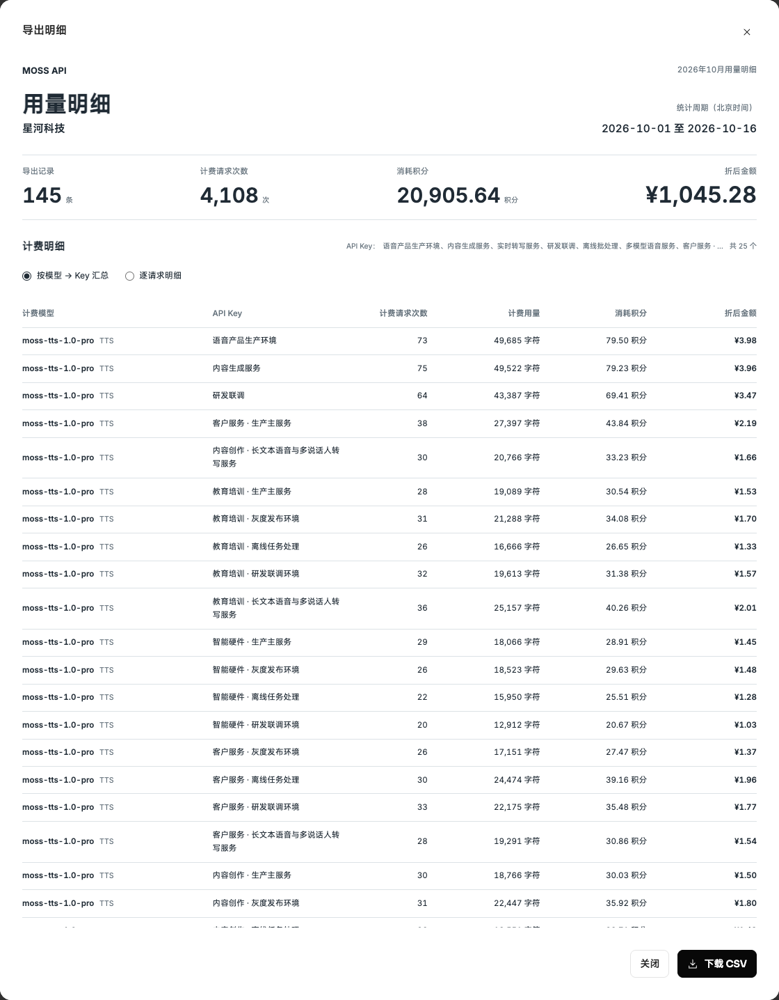

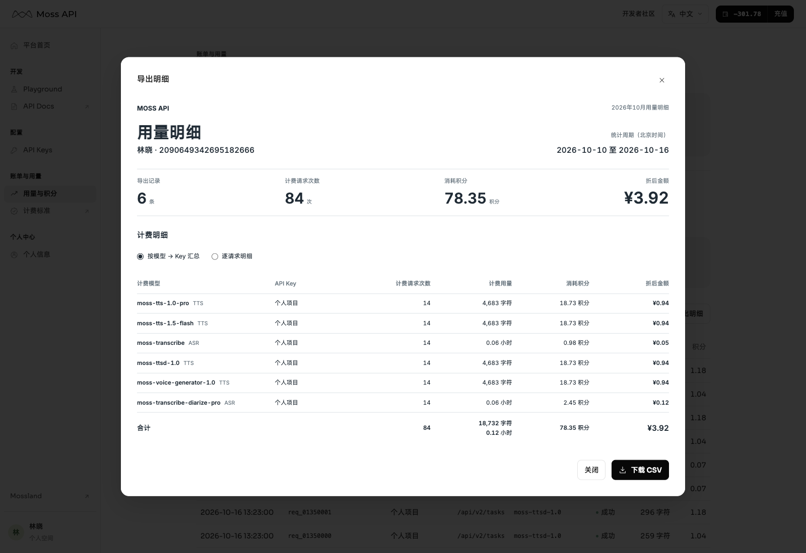

导出明细 · 请求明细：导出记录统计全部已同步请求，计费请求次数仅统计积分大于 0 的请求；CSV 金额保留 4 位小数。

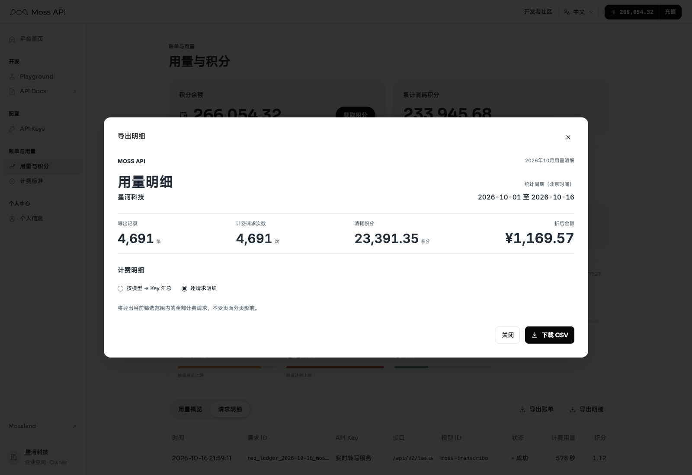

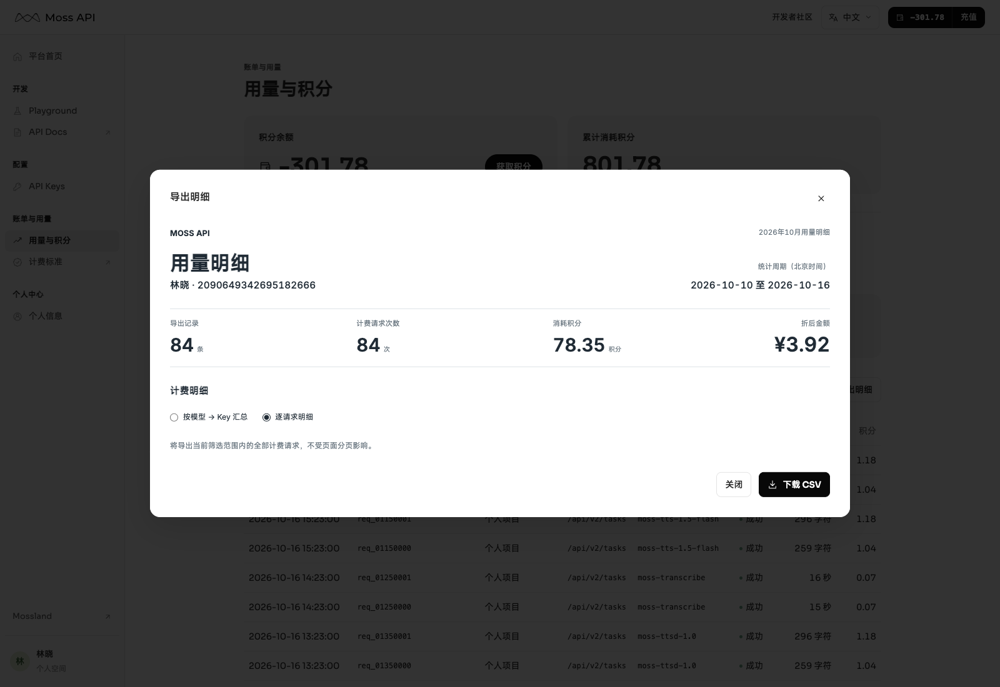

入口及弹窗标题保留“导出明细”，文档标题为“用量明细”。标题、账户、日期、摘要、表格及合计与账单共用文档模板。个人账户为“用户名 · 用户 ID”，企业为企业名称，CSV 账户字段及文件名沿用同一值。摘要依次为导出记录、计费请求次数、消耗积分、折算金额。

默认“用量汇总（按模型与 API Key）”，可切换“请求明细”；只显示这两个选项。汇总模式每个模型与 Key 组合一行，仅包含计费请求；预览列为计费模型（类型）、API Key 名称、计费请求次数、计费用量、消耗积分、折算金额及合计。请求模式说明为“将导出当前筛选范围内的全部请求（含失败请求），不受页面分页影响。”，包含零扣费记录。导出记录数与计费请求次数分别计算；部分 Key 的右侧摘要沿用账单规则。

导出明细与账单预览共用弹窗尺寸、文档容器、Inter / MiSans 字体、等比字号、摘要留白、表格线条和对齐规范。长内容统一在弹窗正文滚动，关闭与下载按钮固定可达；不使用独立固定 1200px 模板或 320px 高表格窗口。原生滚动条遵循系统设置，不添加常驻轨道；窄屏内容与控件保持可达。

导出明细不显示生成时间页脚或绿色下载成功提示，CSV 表内不增加导出时间列。点击下载后按钮改为“重新下载 CSV”，错误直接显示。账单预览和打印继续使用“折后金额”及生成时间，打印另有页码。

两种 CSV 文件名使用以下格式；每次点击下载重新取得北京时间，精确到秒，后缀 UTC+8：

- 用量汇总：`{账户}_用量汇总_按模型与API Key_{统计开始日期}至{统计结束日期}_导出于{YYYY-MM-DD_HH-mm-ss}_UTC+8.csv`
- 请求明细：`{账户}_请求明细_{统计开始日期}至{统计结束日期}_导出于{YYYY-MM-DD_HH-mm-ss}_UTC+8.csv`

例如：`星河科技_请求明细_2026-09-08至2026-09-17_导出于2026-10-26_12-01-03_UTC+8.csv`。统计日期按北京时间自然日计算，起止日均包含。导出时间取实际点击时刻，不使用打开弹窗的时间。

| 粒度 | CSV 字段 | 预览 / 口径 |
| --- | --- | --- |
| 用量汇总（按模型与 API Key），13 列 | 账户、统计开始日期、统计结束日期、计费模型、API Key ID、API Key 名称、密钥掩码、API Key 备注、计费请求次数、计费用量、用量单位、消耗积分、折算金额（元） | 每个模型与 Key 组合一行；预览保留六列及合计 |
| 请求明细，16 列 | 账户、统计开始日期、统计结束日期、请求时间（北京时间）、请求 ID、计费模型、API Key ID、API Key 名称、密钥掩码、API Key 备注、接口、请求状态、计费用量、用量单位、消耗积分、折算金额（元） | 每个已同步请求一行，包含零扣费失败请求；保留完整请求 ID 和 API Key ID |

CSV 列名与顺序沿用上表。API Key 名称来自 Key 名称，API Key 备注来自 Key 备注；密钥始终为掩码。计费用量与用量单位分列：TTS 为字符，ASR 为秒，Kimi 为 tokens。结算单价、单价单位和导出时间不进入 CSV；历史费率快照保留在内部记录中供追溯。金额来自已结算积分，不按当前价格重算。支持中文、逗号、引号及换行，用户内容进行公式注入转义；Key 删除改名后仍保留稳定 ID。完整字段值不因页面省略而改变。

两种 CSV 的“折算金额（元）”保留 4 位小数，先汇总再统一舍入为 2 位。例：1,079.56 积分按 0.05 换算得到 53.9780 元，页面显示 ¥53.98；不得先把逐请求金额舍入为 2 位后求和。

### 计费标准与积分获取

企业计费标准采用官网个人计费标准页的布局：模型计费标准页头、语音生成 / 音色设计 / 语音转写 / 文本生成四个分组、浅灰圆角表头与左对齐内容，商务定制放在底部。公司页面按模型展示合同单价（人民币）、实际扣除及最低扣费，保留不同模型的价格差异；计费数据继续取当前企业合同，不替换为官网公开价格。人民币数值沿用既有 0.05 元 / 积分换算，历史计费及结算逻辑不变。页面不再展示积分包，充值仍从顶栏入口进入。企业页面移除各分组“适用模型”文字及底部结算规则段落，模型直接列在表格中。Kimi K3 按企业自然月输入与输出总 tokens 分段累进：≤100 M、>100 M、>200 M；各档缓存命中输入 / 未命中输入 / 输出单价分别为 2 / 20 / 100、1.6 / 16 / 80、1.2 / 12 / 60 元 / M tokens，实际扣除按 20 积分 / 元换算。阶梯说明收进月累计用量表头的 Info，页面和 mock 账单共用合同价配置。 四组标题右侧统一显示计费方式：语音生成与音色设计按输入字符，语音转写按输入音视频时长，文本生成按输入 / 输出 tokens；表内保留阶梯、计费项目和价格。基础转写补齐 ≤500、>500、>1,000 小时三档，单价为 0.553 / 0.450 / 0.350 元每小时，实际扣除 11.06 / 9.00 / 7.00 积分每小时。Kimi 模型名单元格跨三档合并，各档内部不画横线，档内上下间距 8px，组外 20px，阶梯之间保留细线。

个人空间导航中的“计费标准”在新标签页打开 https://platform.mosi.cn/app/pricing/；直接访问旧本地路径或在该页切换至个人空间时跳转官网。切回公司空间后，该入口指向本地企业合同页。

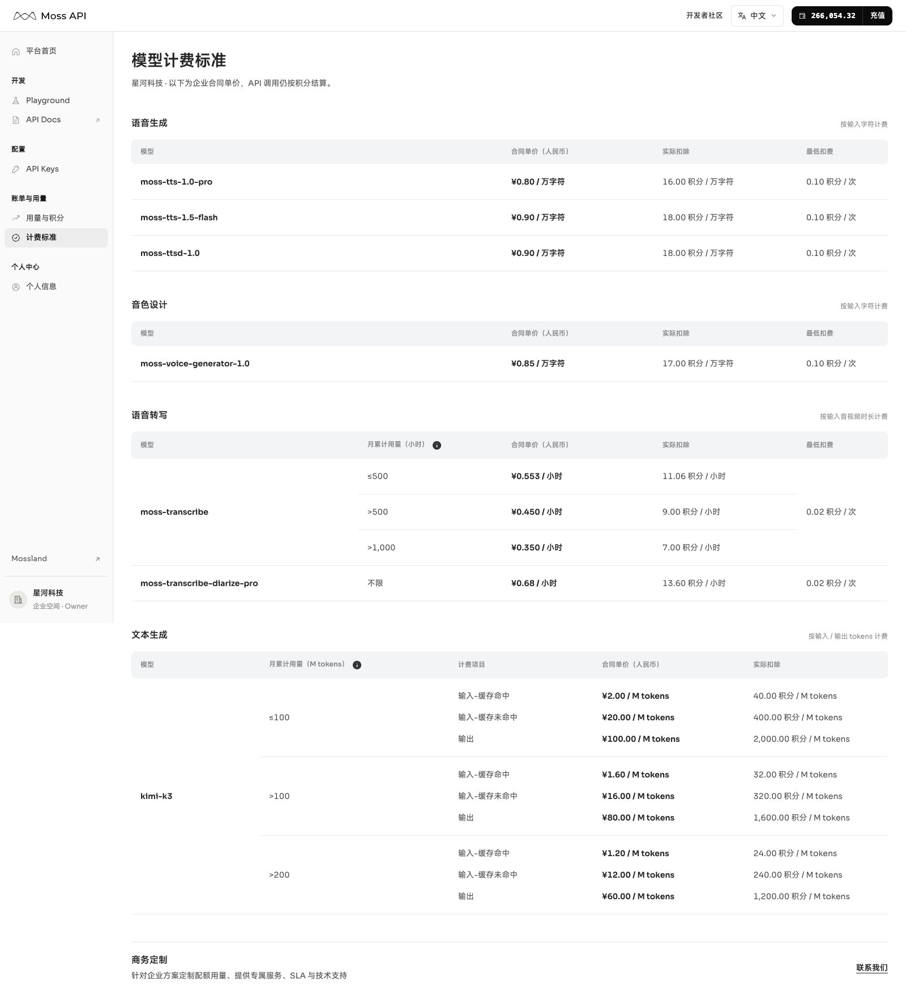

获取积分 · 个人充值：选择积分包与在线支付入口。

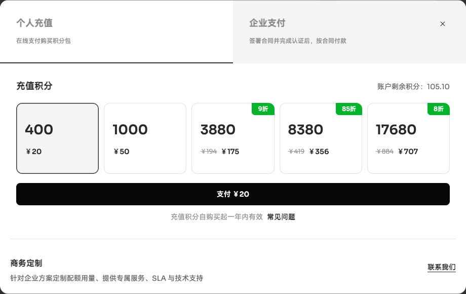

获取积分 · 企业支付：认证对象为当前企业，付款按合同约定。个人充值与企业支付共用弹窗内边距；切换后高度随内容收拢，不沿用用量页的保滚动最小高度，不在底部撑出大块空白。

| 项目 | 当前要求 |
| --- | --- |
| 模型分组 | 企业分为语音生成、音色设计、语音转写、文本生成；计费方式放在标题右侧。阶梯模型保留月累计用量列，Kimi 保留计费项目列 |
| 企业模型价 | 合同单价列展示当前企业生效积分单价对应的人民币金额；实际扣除列展示企业积分单价及单位，不单列公开价和折扣。Owner 只读；保留最低扣费及历史快照逻辑 |
| 个人模型价 | 直接链接官网个人计费标准，不维护本地个人费率页面，不展示企业合同价 |
| 个人账单计费规则 | 依据 2026-10-17 官网：语音生成、音色设计 2 元 / 万字符（40 积分 / 万字符）；基础转写 0.80 元 / 小时（16 积分 / 小时）；说话人分离转写 2 元 / 小时（40 积分 / 小时）。不套用企业折扣、阶梯及官网未列出的最低扣费。个人 mock 保留按请求四舍五入到 0.01 积分的现有精度 |
| 个人 mock 修复 | 账本版本升级至 v5，仅修复旧 platform-list-2026-09 个人 mock 快照及金额；保留请求 ID、用量、时间、Key 和企业历史账单。重复刷新不重建账本；预览、打印、汇总与逐请求 CSV 共用修复后的记录 |
| 历史计费 | 每次请求保存生效单价、单位、模型折扣、最低扣费及内部快照标识，历史金额不由当前价倒算 |
| 获取积分 | 个人充值 / 企业支付页签；积分包选择、应付金额、有效期说明 |
| 个人充值 | 保留原平台积分包与商务定制入口；个人充值页签展示个人余额，积分入个人空间，即使入口来自企业页面也不计入企业余额。未接支付时明确提示并可前往原平台 |
| 企业支付 | 显示当前企业认证状态及收款单位、银行、账号；已认证 Owner 可展开合同 / 付款信息。企业付款按合同核实后入当前企业空间，与个人充值独立 |
| 生产数据 | 认证、合同和收款信息由服务返回；未提供时显示待配置，不能伪造银行账号或二维码 |

“积分换算率”在当前 MVP-P0 中是固定展示参考值，来源于基础积分包的价格与积分数量，不是按筛选范围内的金额与积分动态定价。筛选只改变计入的消耗积分及其金额估算，不改变参考换算率。用未舍入的估算金额除以消耗积分，会反算出同一参考值，没有独立的业务含义；不能从页面已舍入的两位小数金额反推费率。此估算未追踪用户实际购买的积分包、充值优惠或赠送积分，因此不作为实付成本、结算、退款或开票依据。模型折扣在消耗积分阶段生效；充值优惠与模型折扣是不同口径。

### 接口与异常处理要求

| 领域 | 最小数据 / 契约 | 异常要求 |
| --- | --- | --- |
| 空间 | 当前账户、可信企业资格、当前空间、模型权益 | 无资格不能访问；空间切换废弃旧响应 |
| Key | 稳定 ID、名称、掩码、模型策略、备注、状态、创建时间 | 一次性明文仅创建成功返回；并发修改冲突明确反馈 |
| 网关 | 企业 / Key / 模型、策略状态、原子计数 | 未授权 / 停用 / 超限分别反馈；结束幂等释放 |
| 用量 | 筛选条件、自然日时区、同步水位、请求 / Key / 模型 ID、积分 | 加载、失败、无结果、未同步区分；失败不展示伪零 |
| 计价 | 生效单价、单位、折扣、最低扣费、历史快照 | 不按当前合同重算历史；多费率模型可追溯明细 |
| 导出 | 与页面同权限、同筛选、同快照的全部计费记录 | 失败可重试；大数据量采用服务端异步任务 |
| 支付 | 合同主体、认证、收款信息、订单、入账结果 | 未接入与失败区别展示；不得未到账先加余额 |

### 验收场景

历史统一验收（2026-10-16 / 02）：企业与个人、账单预览 / 打印 / 两种导出方式的公共字体、缩放比例、表头、统计和合计一致。账单与模型 → Key 汇总均保留合计，逐请求模式显示范围说明；导出明细无“导出粒度”标题、生成时间页脚和绿色提示，下载文件名含实际时间。金额文案统一为“折后金额”。

多选验收：默认只有“全部”勾选；选择一项、追加第二项、取消一项、取消最后一项、逐项选满后取消一项、点击“全部”均符合 7.5 状态规则；URL 刷新恢复。筛选不会改变 Key 授权。

长度与总数验收：短 Key 名完整；长名在下拉中间省略，末尾名称、Key 尾号和状态可辨，悬停可看全文。选 25 个 Key 时，账单预览、打印每页和导出明细的名称摘要仅一行、末尾省略且完整显示“共 25 个”；全部 Key 隐藏摘要。检查 N 不随有无用量或可见名称数量变化。

检查单页、多页、390px 窄屏、无数据及个人空间；实际 PDF 无内容重叠、额外空白页，合计只在末页。两种 CSV 的积分求和一致，4 位金额相加后舍入 2 位与账单一致。

| 编号 | 操作 / 前提 | 预期结果 |
| --- | --- | --- |
| A01 | 企业 / 个人创建或编辑 Key，取消全部模型，再重新勾选一个模型 | 空选后模型列表下立即显示“请至少选择一个授权模型。”，确认 / 保存禁用；勾选后提示移除，全部字段有效时可提交。取消编辑不改变已保存范围。 |
| A02 | 企业上限100，Key填写0、101或小数 | 阻止提交，提示有效整数范围 |
| A03 | 两个 Key 各80，企业100 | 配置可保存；同时在途仍不超过企业100 |
| A04 | 个人新建 / 编辑 Key | 两列模型可勾选，不要求并发输入 |
| A05 | 个人保存单一模型后刷新和重开编辑 | 授权列和勾选均保持单一模型 |
| A06 | 创建成功关闭弹窗再查看列表 | 只能看到掩码，完整密钥不能再次读取 |
| A07 | 取消编辑 / 服务端保存失败 | 不修改已保存配置，失败保留表单 |
| A08 | 停用 / 删除有历史数据的 Key | 新请求拒绝，历史用量和 ID 仍可查询 |
| A09 | Key 行查看用量后刷新 | URL 恢复 Key 及其他查询条件 |
| A10 | 切换个人 / 企业 | 保留当前功能页面，余额、Key 与用量切换至目标空间；旧弹窗、草稿、筛选及 URL 参数清除；刷新保留目标空间，历史数据不迁移 |
| A11 | 每月1日选择本月 | 本月暂无已同步数据；两个导出禁用 |
| A12 | 组合时间、模型和 Key | 图表、合计、请求、账单与 CSV 使用交集 |
| A13 | 切换数据日期但保持模型 / Key | 企业近24h峰值统计窗口不变 |
| A14 | 同一筛选导出两种CSV并求和 | 积分与账单一致，金额4位求和后舍入2位一致 |
| A15 | 表格翻页后打印或导出 | 仍包含筛选全量，非仅当前页 |
| A16 | 模型名称、备注含逗号 / 引号 / 换行或公式前缀 | CSV 列结构正确，不触发公式执行 |
| A17 | 打印6模型账单与多页账单 | 正文、重复表头和合计完整，不含操作或背景页面 |
| A18 | 页面滚动后，用鼠标及方向键来回切换用量概览 / 请求明细；同时检查窄屏和 reduced-motion | 两种切换均保持滚动位置，不回顶或因内容变短跳动；选中背景过渡为 220ms，减少动态效果时关闭；焦点及面板关联正确，窄屏个人授权卡片单列且操作可达。 |

补充验收：A19，ASR 请求详情和 CSV 以秒为计费用量，概览 / PDF 以小时展示，积分按原始计量汇总；A20，同模型跨多个费率时列出各费率，合计等于已扣积分之和；A21，分别打开创建 Key、充值、购买和获取积分，背景遮罩均为 rgba(0,0,0,0.8)，请求详情最后一行没有多余分隔线；A22，企业页面打开个人充值，展示并入账个人余额，企业合同付款进入企业余额，两者不得串账。

## 交付与上线

### 交付物与版本基线

2026-10-28：请求主表 8 列、详情 12 字段；页面宽度 1200px，单行截断和数值对齐；增加零扣费失败样例。API Key ID 在详情及 CSV 中统一命名。已通过 52 项业务检查、账单与账本回归、ESLint、TypeScript 和生产构建；线上核验 8 列、12 字段及 CSV：基础转写筛选 1,008 条记录，其中计费请求 1,007 条、失败请求 1 条，积分合计 4,085.42。

- [GitHub 功能提交 2beca7c](https://github.com/h-pl/moss-api-mvp-p0-compromise/commit/2beca7caf7861fc9ec24875480edf583441ed3b8)
- [线上请求明细](https://moss-api-mvp-p0-compromise.vercel.app/app/usage?range=7&tab=requests)
- [Figma 请求明细](https://www.figma.com/design/uKJHefil0SBm8xMnc37NnE?node-id=24-1272) · [请求详情](https://www.figma.com/design/uKJHefil0SBm8xMnc37NnE?node-id=39-1397)

### 联调顺序与上线门禁

| 阶段 | 联调内容 | 进入下一阶段条件 |
| --- | --- | --- |
| 空间与 Key | 身份、权益、创建 / 编辑 / 启停 / 删除、一次性密钥 | 隔离及生命周期场景通过 |
| 网关与监测 | 模型授权、两级并发、峰值和配置变更 | 原子接纳与幂等释放验证通过 |
| 计量与导出 | 同步水位、筛选、历史快照、精度、PDF / CSV | 同范围账务核对通过 |
| 支付与发布 | 真实收款资料、订单、入账、异常反馈；发布配置 | 业务负责人确认服务状态和上线证据 |

### 待确认项

| 事项 | 需要结论 | 确认方 / 时点 |
| --- | --- | --- |
| 生产接口 | 空间、Key、并发、计量、导出及支付接口字段与错误码 | 对应后端负责人，接口评审前 |
| 运营数据 | 真实企业权益、合同折扣、认证和收款资料 | 模思运营 / 计费负责人，联调前 |
| 配置生效 | 撤权、降低上限的传播时延及版本校验方式 | 网关 / Key 服务负责人，压测前 |
| 大数据导出 | 同步导出阈值、异步任务状态与下载期限 | 产品 / 后端，导出联调前 |
| PDF | 目标浏览器的实际分页、字体和合计位置 | 设计 / 测试，发布验收前 |
| 负责人 | 具名责任人和相对联调计划 | 项目负责人，研发启动时 |

前端交付收口：本次线上核对发现，用量页面的浏览器标签标题仍为“API 密钥 — Moss API”。研发实现时须随当前功能页面更新为相应标题，并验证空间切换后保持正确；正文页面标题及本轮业务规则不受影响。

上线前以真实服务联调证据关闭以上事项。交互原型的可点击状态和演示数据，不替代生产能力确认。
