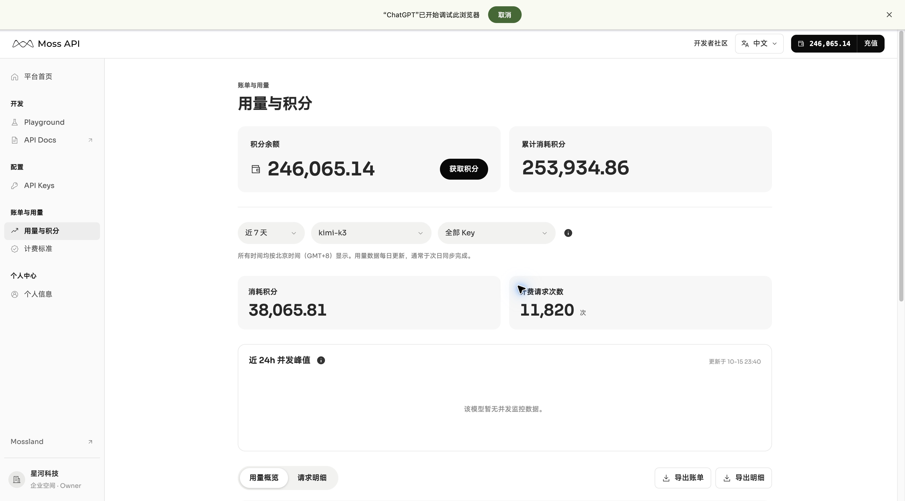
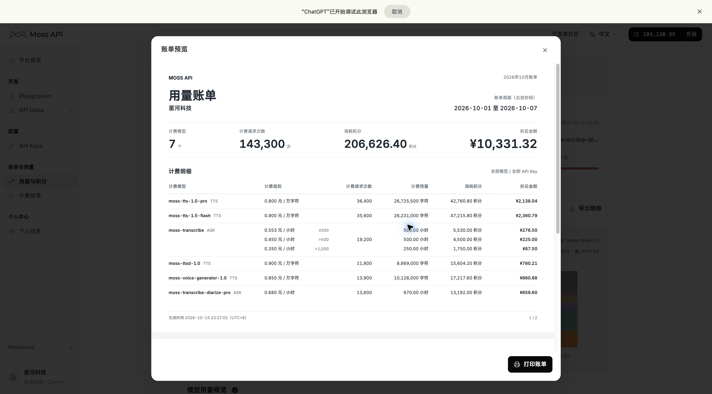
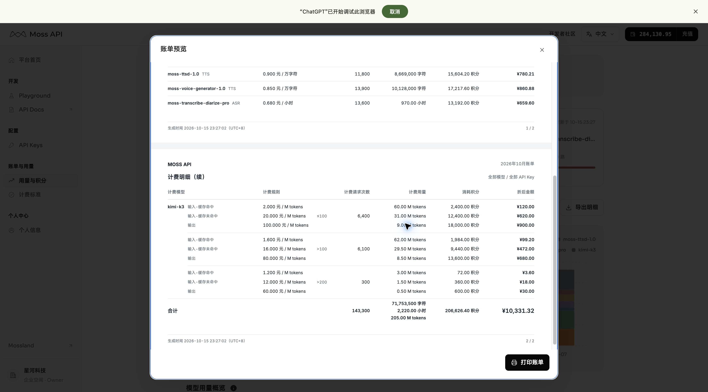

# 2026-10-15 账单与 Kimi 用量更新

发布仓库为 h-pl/moss-api-mvp-p0-compromise，main 自动部署至 [Vercel 线上原型](https://moss-api-mvp-p0-compromise.vercel.app/app/usage?range=7)。代码提交 [3074509](https://github.com/h-pl/moss-api-mvp-p0-compromise/commit/3074509)、[28fbe0e](https://github.com/h-pl/moss-api-mvp-p0-compromise/commit/28fbe0e) 已部署成功。

## 改动

- Kimi 按输入输出总 tokens 分段累进，每档列出缓存命中、未命中、输出单价和用量；请求次数每档只计一次。ASR 示例分三档。
- 计费模型列收窄，计费规则左移，灰色门槛右对齐且不换行。保持原模板字体、行距和 padding。
- 两页账单显示“计费明细（续）”，合计仅出现在最后一页；第一页末行无表格底线。屏幕预览不再用纸张高度撑出底部空白，打印保留 A4 横向尺寸。
- 合并跨日期的新旧同模型、同规则数据，修复重复模型行与多余分页；不同历史费率仍保留结算快照。
- 十月每天补齐 Kimi。10 月 15 日的近 7 天包含 11,820 次、196.19 M tokens；个人数据及六个语音模型授权不变。
- Kimi 单独筛选时未配置并发监控，显示对应空态，不误报“没有历史请求”。

## 验证

46 项 Platform 业务检查、账单专项检查（各档、合计、分页、跨日期合并、近七天覆盖、请求 ID 唯一、筛选隔离、两种 CSV 对账）、TypeScript 和 ESLint 通过；Vercel 生产构建成功。固定首周模板的同源打印正文生成 PDF，确认 A4 横向两页。原生打印对话框本轮未重新验收。

近 7 天 Kimi 的线上数据已核对；以下为本地筛选页验收截图：

线上账单预览截图：

[飞书 PRD](https://acnc6zeentra.feishu.cn/docx/S9zbdxp89oGfXYxKWkTc22QAnef) 的 7.5–7.7、版本基线及原有更新日志表格已同步；历史图片和白板保留，旧打印图标记为历史参考。本次未修改 Figma。
