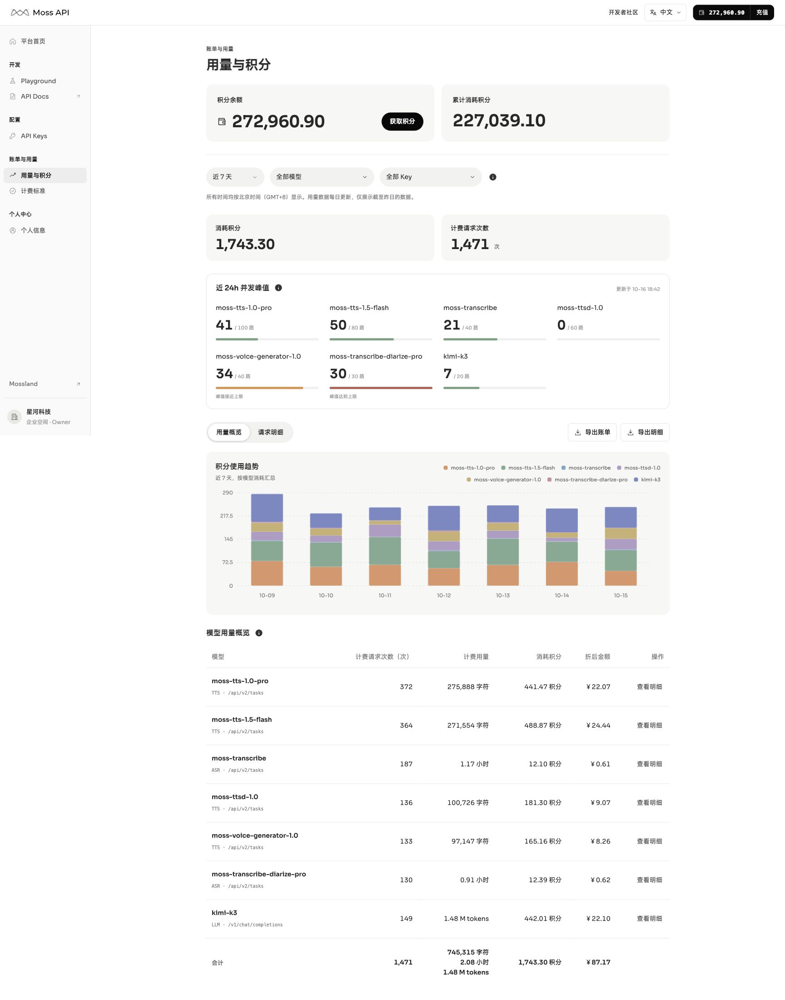
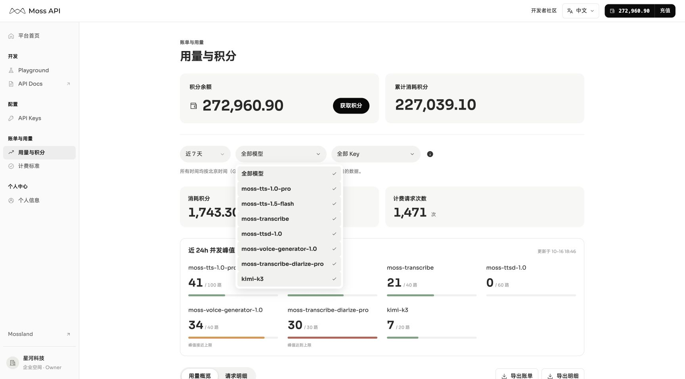
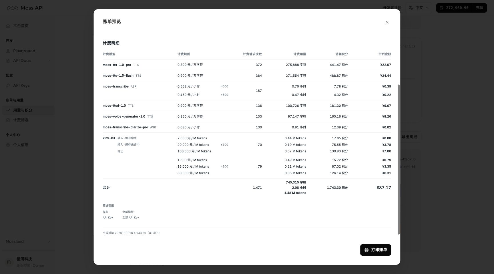
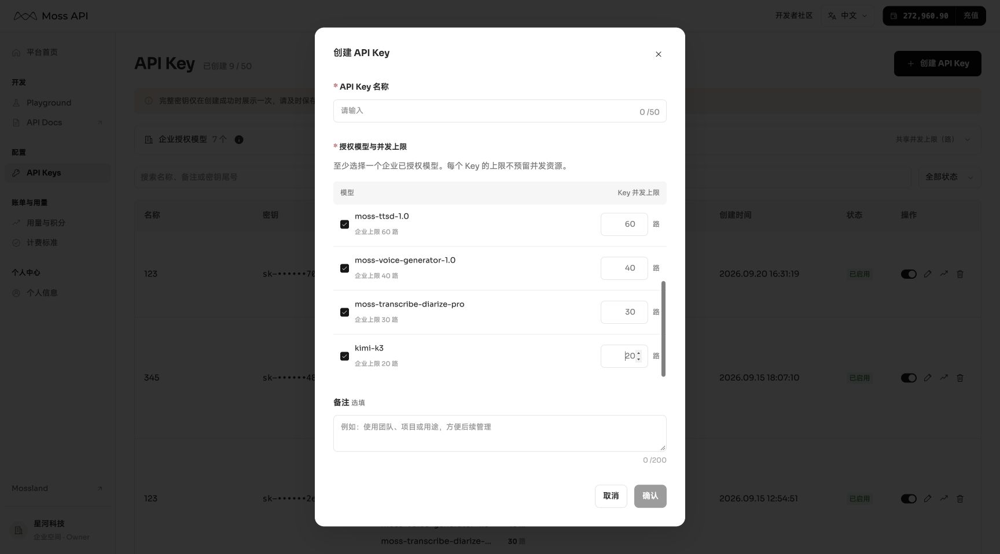

# 2026-10-16 用量筛选、阶梯账单与弹窗更新

发布目标：[Moss API](https://moss-api-mvp-p0-compromise.vercel.app/app/usage?range=7)。本次以当前已确认的本地界面为准，保留 Kimi 功能并替换之前过量的近七天 mock。

## 本次行为

- 模型与 API Key 支持多选；同类条件取并集，两类之间取交集。“全部”对应各项选中，使用右侧勾选标记。URL 可恢复多个选择。
- 企业模型授权、Key 表单和近 24 小时并发补齐 kimi-k3（企业上限 20 路）；个人权限不扩展。新增模型不自动修改已有 Key 授权。
- Kimi 图表采用柔和靛蓝；概览模型列收窄，数值继续右对齐。
- 账单预览与打印沿用 Inter / MiSans、既有字号和列宽，以实际高度决定分页，不通过缩字号强行合页。续页显示“计费明细（续）”，合计只出现一次。
- ASR 与 Kimi 门槛在单价后统一右对齐，不换行、不添加括号或单位。Kimi 输入输出标签仅在首档出现，档间取消分割线；同档三行间距 3.5、档间距 9（842 × 595 模板单位）。横线统一为 0.75 单位、#dce2e6。
- 筛选范围跟随合计，模型、API Key 各占一行，超出省略；字号 8、行高 12、#66737d，与页脚辅助文字一致。
- 弹窗统一桌面 32px / 窄屏 20px 内边距；Key 表单只在模型列表内滚动，最后一行无底线。滚动条采用原生自动显示与统一灰色，无常驻轨道。积分弹窗随内容收拢，避免切换页签撑出空白。
- mock 采用持久化按日账本，按北京时间 T−1 同步，跨月阶梯重新累计，刷新不改变已结算记录。近七天演示利用月初累计跨档，Kimi 保持几百积分；不在筛选区间重新计算历史费率。

## 验证与交付边界

51 项 Platform 检查、账单专项、持久化账本与跨月检查、TypeScript、Next.js 生产构建通过。PDF 字号与版式按共享打印模板保留；本轮尚未收到用户自行保存的 PDF，因此不将页面截图作为实际 PDF 线宽验收结论。

[飞书 PRD](https://acnc6zeentra.feishu.cn/docx/S9zbdxp89oGfXYxKWkTc22QAnef) 同步对应规则、线上截图、版本基线，并在原更新日志表格添加本批记录。Figma 本轮不更新。

## 发布核对

功能提交：`805657e`；全选状态补正：`3fe0f3f`。两次 main 推送对应 Vercel 构建均成功，生产域名已验证新版本。线上近七天 Kimi 为 149 次、442.01 积分；模型与 Key 全选、取消单项后保留其他选择已验证。此次未创建 Key 或执行支付。

截图已同步飞书 7.3、7.5、7.6、7.7、7.8，原更新日志表格新增 2026-10-16 / 01，8.1 更新功能基线；图片均为实际生产浏览器截图。

