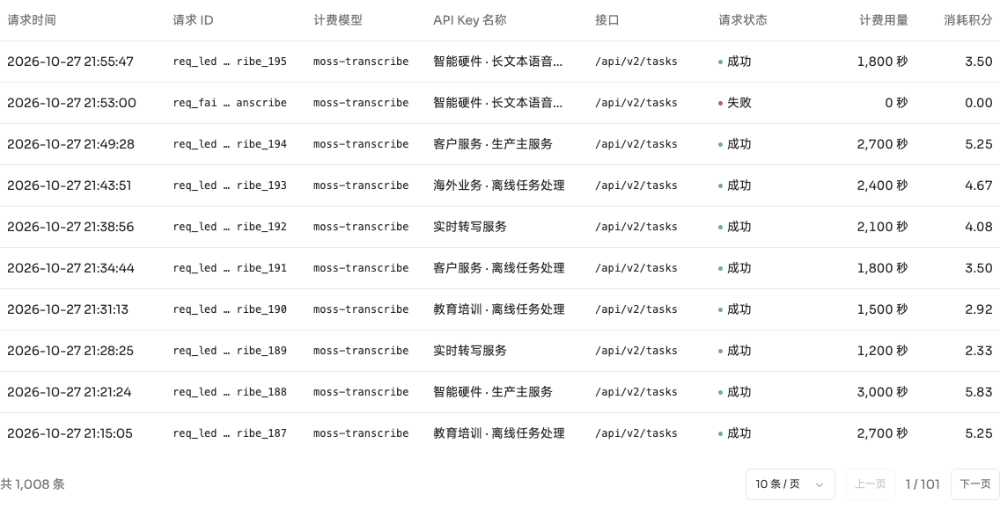
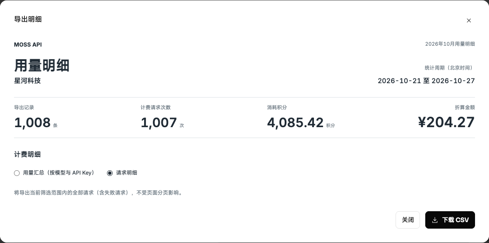

# 2026-10-28 请求明细交付

功能提交：[2beca7caf7861fc9ec24875480edf583441ed3b8](https://github.com/h-pl/moss-api-mvp-p0-compromise/commit/2beca7caf7861fc9ec24875480edf583441ed3b8)。Vercel 正式部署 `dpl_CnowSuAu8h8JJmFtEPzFtDhRLEGn`，状态 READY。

- [正式请求明细](https://moss-api-mvp-p0-compromise.vercel.app/app/usage?range=7&tab=requests)
- [飞书 PRD](https://acnc6zeentra.feishu.cn/docx/S9zbdxp89oGfXYxKWkTc22QAnef)
- [Figma 企业请求明细](https://www.figma.com/design/x9fxtgxEWEpIAKwyGKQz8K?node-id=121-7626) · [企业详情](https://www.figma.com/design/x9fxtgxEWEpIAKwyGKQz8K?node-id=121-5946)
- [Figma 个人用量概览](https://www.figma.com/design/x9fxtgxEWEpIAKwyGKQz8K?node-id=121-9300) · [失败请求详情](https://www.figma.com/design/x9fxtgxEWEpIAKwyGKQz8K?node-id=188-3917)

## 最终行为

主表 8 列：请求时间、请求 ID、计费模型、API Key 名称、接口、请求状态、计费用量、消耗积分。计费用量合并数字和单位，数值列右对齐；请求 ID 点击打开详情，无复制按钮。

详情 12 字段：请求时间（北京时间）、请求 ID、计费模型、API Key ID、API Key 名称、密钥掩码、API Key 备注、接口、请求状态、计费用量、用量单位、消耗积分。列表与详情均无折算金额。两种 CSV 保留原有金额、账户及日期字段，标识列统一为 API Key ID。

页签、导出选项和文件名统一为“请求明细”。页面最大宽 1200px；表格最小宽 1100px。列宽为 184 / 160 / 136 / 剩余空间 / 140 / 88 / 152 / 92px；左右内边距 12px、首尾外侧 8px。字段单行，ID 中间省略为 `req_led … ribe_195`；模型和接口末尾省略为 `/v1/chat/compl…`。详情宽 680px，标签 160px，列间距 20px。

账本 v9 补入一条固定失败样例：2026-10-27 21:53:00、0 秒、0.00 积分。请求列表和逐请求 CSV 包含失败请求；计费概览、账单和模型 / Key 汇总沿用积分大于 0 的计费范围。原有请求、结算快照、金额保留；重复迁移不重复新增。

## 验证

- 52 项平台业务检查、账单检查、账本回归、ESLint、TypeScript、生产构建通过。
- 正式站点验证企业和个人均为 8 列、12 字段；页面宽度为 1200px。
- 正式站点实际下载基础转写筛选 CSV：16 列，1,008 条请求，其中计费请求 1,007 条，失败请求 1 条；积分合计 4,085.42。失败行用量、积分和金额均为零。
- 下载文件名包含“请求明细”和实际秒级北京时间；完整 ID、Key 名称及备注保留。
- Figma 复用既有页面与详情入口，原生文本 / Auto Layout 可编辑；8 列起点统一、数值右对齐、12 字段标签不换行；校验企业成功 / 失败请求详情跳转，详情字段为个人和企业共用规范。并发区按 4+3 排列，校正长模型名裁切及列起点。
- 飞书 7.5、7.7、共用说明、更新日志和 8.1 交付基线同步；替换当前请求列表、详情、失败状态和逐请求导出截图。

## 线上截图

## 2026-10-29 Figma 目标更正

当前文件为 [Moss API · 蓝耘月度账单设计](https://www.figma.com/design/x9fxtgxEWEpIAKwyGKQz8K?node-id=112-861)。页面目录按确认截图整理为六页；当前画板清单见 [交接文档](HANDOFF-PRD-Figma-MVP-P0.md)。
